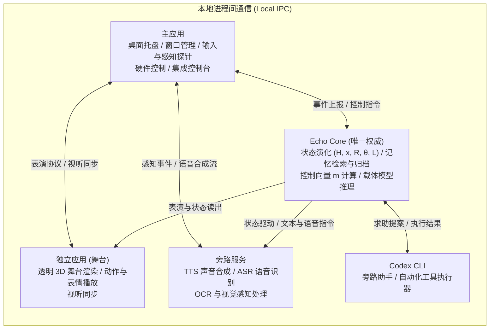

# Nemu

Nemu 是由 [nanake-lab](https://github.com/nanake-lab) 发起并拥有的 3D 桌面伙伴与持续状态演化项目：核心是自主设计的 [Echo Core](https://www.google.com/search?q=docs/echo-core/)，桌面应用是她的身体、感官和声音，[Codex](https://openai.com/codex/) 是她可以求助的旁路助手，不是她本人。

---

## 核心想法

- **从经历中长出来，预设只是起点**：她的状态、倾向和性情从经历与互动中逐步长出来。初始预设（如「联结、共情、好奇、成事」四个基础评估维度与初始依恋先验）只定义演化起点，不作为固定硬约束锁定输出；每一条预设都必须存在被经历改变的路径，无法被经历改变的预设视为缺陷（见 [ADR 0032](https://www.google.com/search?q=docs/adr/0032-presets-as-starting-points.md)）。
- **每一点变化都有来历**：系统拒绝用提示词硬编码人设，也禁止在终端或界面里保存情绪、好感、亲密度等隐藏状态。任何影响她未来行为的持久信息（历史 $H$、快状态 $x$、关系 $R$、慢参数 $\theta$、长期记忆 $L$、队列 $Q$ 等）与行动，只能经 [Echo Core](https://www.google.com/search?q=docs/echo-core/) 的外层权威事务提交与重放验证（见 [AGENTS.md](AGENTS.md) 第 3 节）。
- **Echo Core 第一，声音第二，外观最后**：项目优先在合成世界与排练环境中验证核心规律与状态注入通路，再接通语音管线、签署 `genesis` 完成诞生，最后接入正式外观模型与外部世界交互（见 [tasks/README.md](https://www.google.com/search?q=tasks/README.md)、[开发手记](https://www.google.com/search?q=docs/journal/README.md)）。

---

## 系统架构

依据 [docs/ARCHITECTURE.md](https://www.google.com/search?q=docs/ARCHITECTURE.md) 第 4 节，系统由五个独立进程组成，通过本地进程间通信（IPC）协作；所有外部组件仅能上报事件或提出提案（Proposal），由 **Echo Core** 作为唯一权威提交状态更新：

- **载体推理与控制向量注入**：运行时基线采用 `llama.cpp` 驱动 `Qwen3-4B-Instruct-2507`（`Q4_K_M`），并在每次更新控制向量 $m$ 时显式清除键值缓存与循环状态后重新预填充（[ADR 0031](https://www.google.com/search?q=docs/adr/0031-carrier-engine-and-injection.md)）；条件切换至 `Qwen/Qwen3.5-4B` 的方案须待 `P0-12` 实测通过后生效（[ADR 0034](https://www.google.com/search?q=docs/adr/0034-qwen35-4b-conditional-carrier.md)）。
- **声音管线**：长期目标采用 `Breeze TTS 2`（中、英双语），当前过渡期使用 `GPT-SoVITS V5` 验证声音管线；识别与文字支持中、英、日三语，语音输出语言随目标声音模型，声音不支持的语言只用文字回答（[ADR 0027](https://www.google.com/search?q=docs/adr/0027-voice-model-breeze-target-gsv-interim.md)）。

---

## 里程碑与进度

项目于 2026-10-26 按「Echo Core 第一，声音第二，外观最后」重排为 `N0` 与 `E1`–`E5`，不再推算承诺日期。以下统计来自 [tasks/README.md](https://www.google.com/search?q=tasks/README.md) 项目看板（截至 2026-11-11 00:30 Perth）：

| 里程碑 | 阶段目标 | 总卡数 | 完成 | 部分完成 | 进行中 | 可开工 | 等用户 | 等依赖 |
| :--- | :--- | :---: | :---: | :---: | :---: | :---: | :---: | :---: |
| **N0 技术验证** | 窗口策略、载体探针、旁路与路径实测 | 10 | 7 | 3 | 0 | 0 | 0 | 0 |
| **E1 核心闭环** | 规律在合成世界里跑通，验证事件处理顺序、增量重算一致性与回应回路 | 34 | 11 | 12 | 0 | 0 | 2 | 9 |
| **E2 她能想、能说（文字排练版）** | 接上本地载体模型，在排练谱系中持续思考并用文字对话，检验控制向量 $m$ 对表达的影响 | 46 | 10 | 5 | 0 | 3 | 1 | 27 |
| **E3 她有声音** | 接通听说管线（过渡期使用 `GPT-SoVITS V5`），将内部状态传递至声音表现 | 14 | 1 | 1 | 0 | 1 | 1 | 10 |
| **E4 诞生** | Echo Core 通过 v2.0 验收，完成备份封存与恢复机制，签署 `genesis` 进入正式谱系 | 23 | 1 | 0 | 0 | 0 | 0 | 22 |
| **E5 外观与世界** | 接入正式外观模型、动作、网络生活与多说话模式，完成 30 项发布标准 | 22 | 4 | 1 | 1 | 1 | 0 | 15 |

### 正在进行的工作

- **新规律在核心里的实现**：[P5-69](https://www.google.com/search?q=tasks/P5-echo-core.md%23P5-69)（[报告](https://www.google.com/search?q=reports/P5-69/README.md)）、[P5-70](https://www.google.com/search?q=tasks/P5-echo-core.md%23P5-70)（[报告](https://www.google.com/search?q=reports/P5-70/README.md)）已提交，当前处于审查中。
- **载体方向研究**：[R-STEER-01](https://www.google.com/search?q=reports/R-STEER-01/README.md) 首轮单层注入在开发阶段没有选出合格层，目前正在进行文字状态检验。
- **声音管线收尾**：[P4-02](https://www.google.com/search?q=tasks/P4-voice.md%23P4-02) 正在收尾。
- **排练运行状态**：E2 文字排练版当前仍以 `m = 0` 运行。

---

## 现在能做什么、不能做什么

### 现在能做什么

- **工程脚手架与看板工具**：单仓工作区、跨进程契约（[docs/CONTRACTS.md](https://www.google.com/search?q=docs/CONTRACTS.md)）、透明舞台基础验证以及从仓库实时推算卡片状态的看板工具（`pnpm board`）已可用（[tasks/README.md](https://www.google.com/search?q=tasks/README.md)）。
- **核心闭环部分规律与合成检验**：Echo Core 的基础状态结构、部分动力学更新与实验世界验证框架已建立（E1 已完成 11 张卡、部分完成 12 张卡），新规律实现（[P5-69](https://www.google.com/search?q=reports/P5-69/README.md)、[P5-70](https://www.google.com/search?q=reports/P5-70/README.md)）正在审查。
- **本地文字排练与载体推理基线**：基于 `llama.cpp` 与 `Qwen3-4B-Instruct-2507` 的本地推理通路已接通（[ADR 0031](https://www.google.com/search?q=docs/adr/0031-carrier-engine-and-injection.md)），可在 `m = 0` 下运行 E2 文字排练流程。
- **语音识别与过渡期合成管线**：语音识别与 `GPT-SoVITS V5` 过渡合成管线已跑通基础链路，正在进行 [P4-02](https://www.google.com/search?q=tasks/P4-voice.md%23P4-02) 收尾（[ADR 0027](https://www.google.com/search?q=docs/adr/0027-voice-model-breeze-target-gsv-interim.md)）。

### 现在不能做什么

- **控制向量 $m$ 尚未实质改变模型说话表现**：[R-STEER-01](https://www.google.com/search?q=reports/R-STEER-01/README.md) 首轮单层注入在开发阶段未选出合格层，文字状态检验仍在进行中；E2 目前仍以 `m = 0` 运行，尚未实现由 Echo Core 状态向量稳定调制语言输出。
- **目标载体 `Qwen3.5-4B` 尚未切换生效**：[ADR 0034](https://www.google.com/search?q=docs/adr/0034-qwen35-4b-conditional-carrier.md) 为有条件切换决定，须待 `P0-12` 实测通过后才生效。
- **状态尚未调制声音表现**：E3 刚完成 1 张卡，固定文字下随 $m$ 或快状态 $x$ 改变声音表现的链路尚未接通，过渡期参考音频（`P4-03`）尚未选定（[tasks/README.md](https://www.google.com/search?q=tasks/README.md)）。
- **尚未执行诞生（E4），正式外观与网络生活未开启（E5）**：Echo Core v2.0 完整验收、持续认知硬件校准（`P5-17`）与 `genesis` 签署尚未执行；正式外观模型、模式 B/C 与对外网络生活仍待前置依赖完成（[tasks/README.md](https://www.google.com/search?q=tasks/README.md)）。

---

## 隐私与数据

- **她的数据只在本地**：排练谱系存储、诞生后的正式谱系存储以及用于声音克隆的参考音频均只保存在本地设备，绝不提交至公共仓库，也不上传云端（[docs/ARCHITECTURE.md](https://www.google.com/search?q=docs/ARCHITECTURE.md) 第 6.9 节、[ADR 0027](https://www.google.com/search?q=docs/adr/0027-voice-model-breeze-target-gsv-interim.md)）。
- **三类谱系严格隔离**：实验谱系、排练谱系与正式谱系互不可读；AI 编码代理在开发、测试和基准测量时一律使用临时存储，不得打开排练存储或正式存储（[`AGENTS.md`](AGENTS.md) 第 3 节第 14 条）。
- **哪些环节会用到云端服务**：依据 [docs/ARCHITECTURE.md](https://www.google.com/search?q=docs/ARCHITECTURE.md) 第 6.9 节，**除主动对外的网络生活（联网搜索、访问网络社区、使用网络服务）和 Codex 助手调用的 LLM API / 工具外**，所有状态、记忆、核心计算、感知、渲染与声音合成全在本地运行。

---

## 四条底线

- **Nemu 只属于你。** 仓库不得公开，不然没法白嫖 CI。代码、Nemu 本人、Echo Core 规格三者分开管理。
- **美术由你定。** 代理只做候选、脚本和截图，不替你判断好看不好看；整个项目不安排手绘，也不委托外部建模。
- **路线不推翻。** 代理觉得哪里不对，写 ADR 交给你批准；批准前照原设计推进。
- **她的数据不是测试数据。** 排练存储和诞生后的正式存储都只属于她和你，代理开发和测试时一律使用临时存储。

---

## 给执行者

参与施工的 AI 编码代理与协作者请从以下入口查阅规范与任务：

| 路径 | 内容 | 主要读者 |
| :--- | :--- | :--- |
| [`AGENTS.md`](AGENTS.md) | 三个执行者共用的规则：认领与目录规则、16 条黄金规则、命令、报告模板、审查与合并 | 代理 |
| [tasks/README.md](https://www.google.com/search?q=tasks/README.md) | 从这里开始（进度看板、等你处理的事、派活与取卡规则、依赖与里程碑说明） | 项目所有者与代理 |
| [docs/ARCHITECTURE.md](https://www.google.com/search?q=docs/ARCHITECTURE.md) | 架构说明、进程模型与 30 项 v1.0 完成标准 | 代理 |
| [docs/CONTRACTS.md](https://www.google.com/search?q=docs/CONTRACTS.md) | 资产契约、舞台协议、表演协议、终端协议、生成接口、权限分级、身体读出、机会规则（v2.1） | 代理 |
| [docs/echo-core/](https://www.google.com/search?q=docs/echo-core/) | Echo Core v2.0 核心规格（优先）、旧规格原文与转换版、v1.0 范围与集成扩展登记 | 代理 |
| [docs/adr/](https://www.google.com/search?q=docs/adr/) | 架构决策记录（含基线架构、Echo Core 核心、说话模式、排练与诞生、声音模型、载体注入、预设是起点等） | 项目所有者与代理 |
| `tasks/P0-...P7-*.md`、`tasks/cards.json` | 各阶段任务卡定义与静态元数据；通过 `pnpm board`（`tools/status/`）实时推算看板状态 | 项目所有者与代理 |
| `.agents/skills/` | 代理施工技能包（舞台视觉验证、无头脚本、Echo Core 施工方法） | 代理 |

---

## 延伸阅读

- **学习区（[docs/learn/README.md](https://www.google.com/search?q=docs/learn/README.md)）**：面向人阅读的通俗技术讲解，按编号顺序一篇讲透一个问题（例如《01 Echo Core 怎么影响模型》）。当表述与规格或 ADR 不一致时，以规格和 ADR 为准。
- **开发手记（[docs/journal/README.md](https://www.google.com/search?q=docs/journal/README.md)）**：记录项目启动以来的关键决定原因、走过的弯路、时间线与尚未想通的问题（如为什么定下「预设是起点」、为什么把外观放到最后）。

---

## AI Contributors

Nemu 由 [nanake-lab](https://github.com/nanake-lab) 发起并拥有。架构、Echo Core 规格、美术取舍、诞生与所有定稿决定都属于项目所有者。

下列 AI 编码代理按 [`AGENTS.md`](AGENTS.md) 的规则参与施工。它们只修改任务卡允许的目录，所有变动都经 PR 提交，按卡的难度与强制交叉审查范围审查后合并（[`AGENTS.md`](AGENTS.md) 第 6 节）；需要用户确认的事项交给项目所有者决定。

| 协作方 | 提供方 | 通常做的卡与职责 |
| :--- | :--- | :--- |
| [Codex](https://openai.com/codex/) | OpenAI | Echo Core（`core-policy`、`core-kernel` 除外）、worker、执行器、旁路服务、桌面应用、契约与工具链；交叉审查高难度卡及强制审查范围（契约与 IDL、存储格式、行动闸门与权限、网络生活、改规格或契约的 ADR） |
| [Claude](https://claude.com/product/claude-code) (Claude Code) | Anthropic | Echo Core 核心数学链：`core-policy`、`core-kernel`、`experiment-world`，以及核心状态的 IDL（P5-09、P5-21、P5-27、P5-10、P5-12、P5-23 至 P5-26、P5-30）与新规律实现（如 P5-69、P5-70）；审查其余中、高难度卡，每日抽查 |
| [Antigravity](https://antigravity.google/) | Google | 舞台、评审台、角色运行时与身体（`apps/stage`、`apps/panel`、`packages/avatar-runtime`、`packages/body`） |

每张卡的建议执行者以 `tasks/cards.json` 和任务卡头部为准，规则见 [`AGENTS.md`](AGENTS.md) 第 2、6、10 节。
