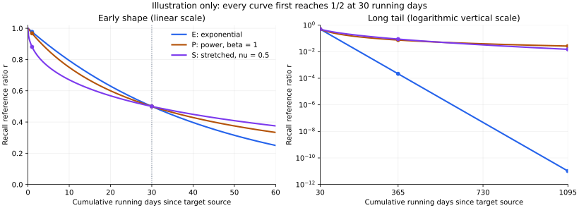

档位：轻档；仅交付请求、数学比较报告与复算/绘图附件，数表是明示假设下的算术比较，不是正式验收测量或预注册研究运行。

# MATH-FADE-CURVE-01：旧事淡化曲线与尺度比较

**建议把无永久底值的双曲慢尾（幂律族的 β=1）作为首选形状候选，指数作为对照，最终由用户选择。** 它起初淡得明显，之后越来越慢；固定 β=1 后没有额外可调的形状参数。**尺度已由用户决定从她的 H 中学得，交 DESIGN-FADE-SCALE-01；本报告不再请人指定倍数，也不预定旧事必须比当前心情淡得慢。** 假设三条曲线都在存在 30 天后首次淡到一半，一年后指数留下约 0.0218%，双曲留下约 7.59%，平方根拉伸指数留下约 8.91%；三年后分别约为 0.00000000103%、2.67%、1.52%，其中 30 天、6 小时、120 倍均只是比较用假设，不是候选值。反复回想不改变这组固定假设下的比例，但能补回已散去的分量，因此仍可能让她比不回想时更久地难过或开心。

**需要用户定的一句白话：旧事是否采用“先淡得明显、后来越淡越慢、没有保底”的双曲线形状？** 只选形状；淡化尺度从 H 学得，具体学习机制由 DESIGN-FADE-SCALE-01 设计。

当前状态：已按交叉审查与用户新决定修订，等待原审查者增量复审和用户选形状；尺度学习设计已交 DESIGN-FADE-SCALE-01，其余实现、时钟与数值合同仍由后继承接。本 PR 保持 draft / needs-user；合并此比较报告不自动采纳形状、示例数值或数值政策，不合并、不接下一卡。

## 1. 基线、材料与本次边界

- 开工时固定 main：`94a8f99f2cbd8d1894f743e0495b26edc3addb44`。
- 工作线：交付线，只读数学比较；[原始请求](../../tasks/requests/MATH-FADE-CURVE-01.md)。
- 完整阅读 AGENTS.md、echo-core-work 技能、v2.0、[ADR 0038][adr38]、[MATH-U2U3-01 报告][math]及其复算附件、[P5-71 S1 报告][s1]；另读 [0035 §4.1–4.7][adr35]，核对 V2-146–149、156–159 的全部追加，以及 [S1 合并误差勘误][s1err]、[0041 的 L1/数值边界][adr41]。
- B、S1、逐坐标、N0、无永久底值均按用户已经批准的结构处理；0038 保留的历史 PROPOSED 状态行不成为重选理由。
- 所有推导均以来源、角色、解释、坐标与时间证明正确为前提；本次不改变它们的资格规则。不把“淡化比例”称为 G/C 的证据权重，也不改 H、原 a、原目标 v 或现行 Φ。

本报告的形状推荐属于待选材料；本轮只记录用户已决定的尺度来源，不定义学习机制，没有改 ADR、差异登记、现有卡或运行参数。尺度如何从 H 学得交 DESIGN-FADE-SCALE-01；其与 0038 §6.5 所列后继的衔接由该设计说明。其余责任仍沿 0038：P5-30/17 后继负责校准验证与资源，P5-70/71 后继负责规范算术，P5-52/72/68 后继负责时钟与引用，P5-75 后继负责恢复和接线，P5-76/77 负责闭环与真实载体。

本轮核对 main 为 `fc5f4c2df1a93ffdcec96d37bc6cde41f9226d64`，开工基线是其祖先。其间新增 #189、#202、#203，共七份文件变更：已核对 [ADR 0042][adr42] 及其登记/报告/请求，按当前 h 选原话并接受不能传达“淡”的损失，不把 h 再乘 r；开发手记记录已有决定与研究候选；AGENTS 新增的轻流程排除仍待用户决定的设计，因此本卡继续完整审查流程。这些变化不改本比较的 B/A1、年龄或来源速度，无需合入 main；比例比较也不等于 API 文字已能表达同样强弱。

### 1.1 对交叉审查的判断与本轮处理

审查对象为 `fbd9f13d307538e8bc5ce5e73f6a61bed059e4b7`，见[原审查评论][review]；用户本轮决定与修订请求原文已追加到[任务请求](../../tasks/requests/MATH-FADE-CURVE-01.md)。先给判断，再修改接受项：

| 位置 / 意见 | 判断与依据 | 本轮处理 |
| --- | --- | --- |
| 开头、§5、§8：遗漏无独立尺度路线，并预设旧事更慢 | 接受阻塞，无反驳。需要时间尺度不等于需要新增独立 K；明确绑定已有量也是结构假设，0038 禁止隐藏等同，没有禁止明示比较 | §4.5 补 K=1 与原始双曲 α=1 的绑定、数值及回想后果；撤回“一个独立尺度就是最少”的说法 |
| 审查建议开放等尺度/其他映射/独立 K 待选；用户随后决定从 H 学得 | 接受补足比较；待选范围以用户新决定为准。这不是否定审查的数学结果 | 开头、§2、§3、§5、§8、限制和 PR 说明只保留形状待选；尺度交 DESIGN-FADE-SCALE-01，不把直接绑定或演示数值重新列为待选 |
| 原 L161：展开平方根时间的双曲措辞 | 接受。原论文摘要的双曲是以平方根时间为自变量，不能读成直接支持本报告的 $1/(1+z)$ | §5.1 改为“平方根时间的指数函数、平方根时间的双曲函数” |

## 2. 先把形状与尺度分开

### 2.1 共同坐标：第一半衰期

对依据 c 的坐标 i，记来源前态中固定的恢复率为 $\widehat\lambda_{c,i}>0$，存在年龄为 $d_c\ge0$。为对齐数表，定义一个**仅用于固定假设比较**的无量纲比值 $K>0$：

$$
T_{x,1/2,c,i}=\frac{\ln2}{\widehat\lambda_{c,i}},\qquad
T_{1/2,c,i}=K T_{x,1/2,c,i},\qquad
z_{c,i}=\frac{d_c}{T_{1/2,c,i}}.
$$

这里 $T_{x,1/2}$ 是固定该起点速率时，当前偏离平复一半所需的数学时间；$T_{1/2}$ 是旧事**补回参考首次降到一半**所需的存在时间。后文简称“第一半衰期”，慢尾的后续每次减半不会仍花同样久。K 是尺度比的记号，不是新增状态或旧 κⁿ；本报告也不据此预定将来有一个全局常数、每件事另存一个 K，或让人校准它。在本节给定同一 K 的假设下，逐坐标差异才完全来自起点速度；从 H 学得的尺度怎样表示和接到 S1，交 DESIGN-FADE-SCALE-01。

三族统一使 $r(0)=1,r(1)=1/2$，且非增、趋零。把 P 归一化成 $P(\ln2)=1/2$ 后，0038 的 $r=P(\alpha\widehat\lambda d)$ 中 $\alpha=1/K$。若使用其未归一化幂律示意 $P(\xi)=(1+\xi)^{-\beta}$，则等价 $\alpha=(2^{1/\beta}-1)/(K\ln2)$。这些只是同一尺度的坐标换算；**不能把 α、K 和天数半衰期当作三个独立待学或待选的量，也不能把不同归一化下的 α=1 当作同一行为。**

### 2.2 每族都走同一个 B → A1 入口

按 [0038 §3.3][adr38]：先按原 Φ 推进 x/各槽一次；解析来源原前态及有效解释得到 v；纯重访求 r，然后

$$
w_i=\operatorname{RN}(r_i v_i),\qquad
q_i=\operatorname{clamp}\bigl(w_i,[\min(h_i,v_i),\max(h_i,v_i)]\bigr).
$$

q=h 的坐标数值恒等，其余用原 A1 的规定分支和逐步舍入替换。新依据/真实目标更新用 r=1。q/w 不写回成 v，不能下次再折扣一次；每条合法重访仍原子消费，重复传输不再作用。

一个精确例子：v=−1/2、现存 h=−3/8、r=1/8，则 w=−1/16，q=−3/8，回想不额外扣掉仍在的残量。等 h 自然平复到 −1/64，再回想才补到 −1/16（假定无饱和）。三族只决定 r 的大小，均保留这个保护。

## 3. 曲线族：参数、随时间的变化与取舍

令 $L=\ln2$、$c_\beta=2^{1/\beta}-1$。

| 曲线族 | 归一化比例 r(z) | 数学参数及意义（非人工待选尺度） | 随存在时间的变化 |
| --- | --- | --- | --- |
| E：指数尾 | $2^{-z}$ | 1 个尺度输入 $T_{1/2}$，在比较表中用 K 表示；无额外形状参数 | 每再过一个第一半衰期，剩余参考再减半；相对淡化速度恒定 |
| P：平移幂律尾 | $(1+c_\beta z)^{-\beta}$，β>0 | 2 个：$T_{1/2}$ 定尺度、β 定形状；选定 β=1 子族后仅需尺度输入 | 同一第一半衰期下，β 越小，远期尾巴越重；β→∞ 时趋向本表指数；固定 β 时最终按 $z^{-\beta}$ 淡化 |
| S：拉伸指数尾 | $2^{-z^\nu}$，0<ν<1 | 2 个：$T_{1/2}$ 定尺度、ν 定形状；ν=1 退化为 E，不另计一族 | 最初淡得更急，后来相对速度下降；最终比任何固定幂律都快、比指数慢。ν=1/2 是本报告的算例 |

这里的尺度输入由 H 学习机制提供，如何学由后继设计；计入一个数学尺度输入不等于新增一个独立经验常数。β/ν 属于形状选择，不能用示例的 K 替它们定型。

相对淡化速度 $-d\log r/dd$ 分别为

$$
\frac{L}{T_{1/2}},\qquad
\frac{\beta c_\beta}{T_{1/2}(1+c_\beta z)},\qquad
\frac{L\nu}{T_{1/2}}z^{\nu-1}.
$$

这几项是数学结果，不是给她另加的速率状态。P 的 β=1 时，参考从 1→1/2、1/2→1/4、1/4→1/8，分别花 $T_{1/2}$、$2T_{1/2}$、$4T_{1/2}$；这就是“越往后越慢”的具体含义。S 在 d=0 右侧斜率无界，但函数连续且 r(0)=1；它会把很小的年龄增量放大为相对更明显的早期变化，数值与短时体验都更难校准。

给定固定合法尺度时，三族都有 r→0。结合 [MATH-U2U3-01 §6][math]，在有限旧依据、目标有界、存在年龄持续增长、没有来源重置或未淡化支路、静息点/坐标满足该定理条件、恢复量累积发散且无 Zeno 的**实数**语义下，都能使纯旧事重访的状态回到静息点。P 即使 β≤1、$\int_0^\infty r(d)\,dd$ 发散，也不破坏这个定理：这里是同槽有限补回，不是每次另加一个脉冲。该结论不等于整个自主认知闭环必然平静。

### 3.1 其他路线为何不继续加参数

| 路线 | 本次处理与理由 |
| --- | --- |
| 快慢两项指数混合 | 有限混合仍以最慢指数为远尾；至少增加混合比例与相对速度，额外假定一件事有两个时间尺度。现无支持其必要性的目标或数据，暂不深入 |
| 有限时限线性/分段归零 | 可以趋零，但把一个数学时间点变成未来补回参考的硬终点；不为工程释放槽采用这种行为决定。即便 r=0，治理纠正仍可能作用，见 §6 |
| 阶梯、任意插值表 | 增加节点和日期跳变，容易把演示观察点变成门槛；不推荐 |
| 极慢对数尾 | 如 $1/(1+\log(1+z))$ 经归一化后也能满足性质，但更长的记忆尾没有新增需求支撑，当前不为此增加选择负担 |
| 永久底值、正负倍率、按次数改变速度、重大性分类 | 已选结构排除，不重新列为待用户批准的运行选项 |

## 4. 具体情景的数值

### 4.1 对齐情景：累计运行 30 天后第一次减半

**本节情景全部是比较假设，其中时间尺度和倍数不是候选值：**一件事在 d=0 已首次理解并完整作用，之后目标来源、解释和坐标不变；起点平复半衰期取 6 小时，K 取 120，故该坐标第一半衰期为 30 个存在日。取 v=−1/2；正向镜像把符号反过来，比例完全相同。一天为 86,400 秒，一年为 365 天，三年为 1,095 天，不作日历闰年解释。日期指被证明的累计运行时长；“一年前的事今天才知道”从今天这次理解作用起算。

| 存在年龄 | E 指数 r | P 双曲 β=1 的 r | S 平方根拉伸 ν=1/2 的 r |
| --- | ---: | ---: | ---: |
| 1 天 | 0.9771599684（97.716%） | 0.9677419355（96.774%） | 0.8811294028（88.113%） |
| 30 天 | 0.5（50%） | 0.5（50%） | 0.5（50%） |
| 1 年 | 0.0002175045699（0.0217505%） | 0.07594936709（7.59494%） | 0.08912197889（8.91220%） |
| 3 年 | $1.028975794\times10^{-11}$ | 0.02666666667（2.66667%） | 0.01518169847（1.51817%） |

一年后对应的参考 w 分别为 −0.0001087522849、−0.03797468354、−0.04456098944；三年后为约 $-5.144878969\times10^{-12}$、−0.01333333333、−0.007590849235。这是参考量，实际 h/x 还要过 B 和 A1，不能把表直接当作她当时心情。

左图用普通纵轴看最初 60 天，右图用对数纵轴看长尾。S 在一年时比 β=1 的 P 更大，三年时反而更小；“慢尾”是远期类别，不保证在所有年龄点都排同一个名次。

### 4.2 幂律的形状参数不能藏起来

相同第一半衰期，β 改变的不只是一个等价速度：

| 存在年龄 | β=1/2 | β=1（推荐子族） | β=2 |
| --- | ---: | ---: | ---: |
| 1 天 | 0.9534625892 | 0.9677419355 | 0.9729473223 |
| 30 天 | 0.5 | 0.5 | 0.5 |
| 1 年 | 0.1632993162 | 0.07594936709 | 0.02741472448 |
| 3 年 | 0.09513029883 | 0.02666666667 | 0.003848884287 |

β=1 的理由是减少自由形状参数，并让比例可由加法/除法表达；不是论文证明了 β 恰好等于 1。固定 ν=1/2 也同样是一项形状假设，不能因用了平方根就称为没有预设。

### 4.3 每天回想与从不回想

进一步冻结**当前**平复半衰期也为 6 小时，令 b=0、单槽、x=h、初始 h=v，不饱和；这使两条时钟在持续运行期间一致，且一天的自然保留量为 1/16。令 $m=|h|/|v|$。不回想时与每日回想时的实数递推为

$$
m_{\rm never}(d)=2^{-4d},\qquad
m_n^- = m_{n-1}^+/16,\qquad
m_n^+=\max(m_n^-,r(n)),\quad m_0^+=1.
$$

| 年龄 | 一直不回想的 m | 每日回想：E 的回想前 m | 每日回想：P 的回想前 m | 每日回想：S 的回想前 m |
| --- | ---: | ---: | ---: | ---: |
| 1 天 | 0.0625 | 0.0625 | 0.0625 | 0.0625 |
| 30 天 | $7.523163845\times10^{-37}$ | 0.03198043412 | 0.03177966102 | 0.03161620287 |
| 1 年 | $3.134774682\times10^{-440}$ | 0.00001391178114 | 0.004758883249 | 0.005588615127 |
| 3 年 | $3.080484244\times10^{-1319}$ | $6.581418517\times10^{-13}$ | 0.001668149466 | 0.0009506726850 |

每个观察日**回想之后**，这组假设下三族的 m 都等于 §4.1 各自的 r。若此前从不回想、恰在观察日第一次重访，本例也补到相同 r；区别在于每日回想者在此前每一天都补过，而不回想者此前仅自然平复。无论回想了几次，观察日的 r 都相同；在同年龄、同前态条件下重复回想不变成 r²、r³。

上表的极小值是高精度实数公式近似，**不是声称 binary64 能保存 $10^{-440}$ 或 $10^{-1319}$**，更不是现行逐提交 Φ 的位模式。真实 binary64 的早期舍入、零与停滞分开见 §6。若当前恢复很慢，m 可以高于当日 r，B 会保留 m；不能把本例的“回想后恰好等于 r”推广到所有历史、饱和或反号槽。

### 4.4 尺度敏感性：同样一年，结果可差很多

仍看同一参考坐标，单独改变 K，使其第一半衰期为 7、30、365 天（对应 K=28、120、1460）；这些数都只是展示跨度的假设，**不是候选值、搜索范围或正式参数**。

| 第一半衰期 | 一年后 E | 一年后 P，β=1 | 一年后 S，ν=1/2 |
| --- | ---: | ---: | ---: |
| 7 天 | $2.011110532\times10^{-16}$ | 0.01881720430 | 0.006702889576 |
| 30 天 | 0.0002175045699 | 0.07594936709 | 0.08912197889 |
| 365 天 | 0.5 | 0.5 | 0.5 |

所以不能只选“指数/幂律”就声称已经确定体验。在固定同一 K 的这组假设下，另一坐标的起点 λ 若减半，其第一半衰期自动加倍；这不是对未来学习尺度的表示或共享方式作决定。已选 S1 的来源速度不拿当前 λ 追改，学习尺度与来源的绑定交后继设计。

### 4.5 已比较的直接尺度绑定：不再列为待选

下表补齐[审查指出的遗漏][review]，仍以来源平复半衰期 6 小时为假设。两条路线都不增加独立尺度常数，但都增加了明确的等同关系；**“没有新增独立参数”不等于“没有新增假设”**。用户已决定尺度从 H 学得，以下只记录比较依据，不列为待选，不预定 H 应学到这些结果。

| 已比较路线 | 明确绑定了什么 | 因该绑定舍弃了什么 |
| --- | --- | --- |
| 本报告归一化下 K=1，适用于 E/P/S | 旧事的第一半衰期等于来源平复半衰期；本例都是 6 小时 | 不再独立适配两个第一半衰期的比例；它不同时保证 P/S 的起点相对速度等于来源 λ |
| 原始双曲 $r(d)=1/(1+\widehat\lambda d)$，α=1 | 起点相对淡化速度等于 $\widehat\lambda$；第一半衰期是 $1/\widehat\lambda$，故 K=$1/\ln2\approx1.442695041$，本例约 8.656170245 小时 | 不再独立适配两类起点速度的比例；它没有把两个第一半衰期设为相等，也不是上一行的 K=1 |

| 存在年龄 | K=1：E | K=1：P，β=1 | K=1：S，ν=1/2 | 原始双曲 α=1 |
| --- | ---: | ---: | ---: | ---: |
| 1 天 | 0.0625 | 0.2 | 0.25 | 0.2650699755 |
| 30 天 | $7.523163845\times10^{-37}$ | 0.008264462810 | 0.0005039432329 | 0.01187963624 |
| 1 年 | $3.134774682\times10^{-440}$ | 0.0006844626968 | $3.145285090\times10^{-12}$ | 0.0009871718171 |
| 3 年 | $3.080484244\times10^{-1319}$ | 0.0002282583885 | $1.194985793\times10^{-20}$ | 0.0003292739724 |

同为双曲形状，K=1 的一年/三年参考约为 0.06845%/0.02283%，原始 α=1 约为 0.09872%/0.03293%，均与 K=120 示例的 7.59%/2.67% 相差很大。表中极小值仍是实数公式近似，不是 binary64 输出。

**K=1 的 E 有特殊的回想后果。** 在 §4.3 的单槽、b=0、x=h=v 起步、无饱和/修订/更新，当前 λ 始终等于来源 λ，且存在时间与 Φ 时间一致的实数情景中，$r(d)=e^{-\lambda d}$，已有 $h(d)=v e^{-\lambda d}$。因此每次 w=h、q=h，任意频率的纯回想都不额外补回，每日回想与从不回想数值相同。停机令两钟分离、当前恢复加快、初始饱和未装满等，都可能重新出现补回；实数相等也不承诺 binary64 逐位相等。

**同一 K=1 的 P/S 不发生上述全程恒等。** 令 $T_x=T_{x,1/2}$、$z=d/T_x$，在 0<z<1，两者的 r 低于自然指数 $2^{-z}$，B 保留现有残量；z>1 时高于自然指数，可在后期补回。每日采样从 z=4 开始，本例回想后 m 仍等于上表三族各自 r，但 E 的相等没有新增补回。原始双曲 α=1 则由 $e^s>1+s$（$s=\widehat\lambda d>0$）得到 $1/(1+s)>e^{-s}$，其参考从正年龄开始就高于同速率自然指数，在这组条件下可补回。

## 5. 尺度从哪里来

### 5.1 已有来源与仍然是假设的部分

| 项目 | 有何依据 | 不能由它推出什么 |
| --- | --- | --- |
| 存在年龄 d | 0038 §3.2：当前 H 前缀中，来源提交之后的有效运行区间并集 | 墙钟一年不是存在一年；无证明的空档不自动计入 |
| 起点恢复率 $\widehat\lambda$ | 0038 §6；v2.0 §8、ADR 0029/V2-95：从合格外源时长学得 τ，再映射及限幅；按来源原前态冻结 | 这是当前感受平复的速率；与淡化尺度相等需明示绑定，不能隐藏等同。§4.5 已比较两种绑定，其上下界也不是已校准的回想界 |
| 正负同曲线、无底值、真实更新才重起 | 本次用户已定结构及 0038 | 不给出哪天剩多少，也不要求一年后释怀 |
| E/P/S 家族 | 0038 已列 E/P；遗忘研究提供其他值得比较的形状，[外部来源 S1–S3](#外部来源)见下 | 记忆回忆/再认成绩不等于 F 的感受份额，不能搬实验中的天数、斜率或人的睡眠时间来当 Nemu 尺度 |
| β、ν 等形状取舍 | 本报告的候选形状；由用户选择 | 没有来源证明 β=1 或 ν=1/2 就是“像人” |
| K 记号及 6 小时、30 天、120 倍等演示值 | 固定输入的数学比较；另有 §4.5 的直接绑定对照 | 不是候选值、学习默认值、先验、搜索边界或拟合目标；没有校准结果 |
| 实际淡化尺度 | 用户本轮已决定从她的 H 学得；交 DESIGN-FADE-SCALE-01 设计 | 本报告未定义学习算法、证据不足时的行为或学习结果；不由人指定倍数 |

**已核查的外部证据：**Wixted 与 Ebbesen 1991 的摘要报告词语回忆、面孔再认和鸽子延迟匹配中幂律优于其比较的其他函数；其 1997 原作者再分析中，词语间隔为 2.5–40 秒，面孔为 1 小时–2 周，且面孔实验不能给出每个人自己的时间曲线。Rubin 与 Wenzel 对 210 个已发表数据集比较 105 种双参数函数，幂律、对数、平方根时间的指数函数、平方根时间的双曲函数拟合较好，数据难以区分，自传记忆又是例外；后者不直接支持本报告的普通双曲 $1/(1+z)$。[S1][paper91] [S2][paper97] [S3][rubin]

另外，Murre 与 Chessa 在**个体指数曲线且速率服从 Gamma 分布**的假设下，推导出总体幂律；这是聚合的数学结果，不是“每个个体都是指数”的实验结论。[S4][murre] 因此，不能拿总体长尾替个体选 P，也不能拿指数的简洁性宣称人类情感一定指数淡化。这里的文献作用是提供候选和辨识警示，没有一项直接测量 Nemu 的 r。

### 5.2 尺度来源已定：交 DESIGN-FADE-SCALE-01

**本报告只请用户选形状，不再请用户给半衰期、指定倍数或选择尺度绑定。** 尺度从她的 H 学得；学习所用的合格事实、如何识别尺度、证据不足时怎样处理、何时绑定到目标来源，以及与已选 S1/重放规则的衔接，都交 DESIGN-FADE-SCALE-01。本卡不提前规定学习算法、共享范围或更新形式，不用示例偷偷填初始化值。

未来核验仍需区分：学得尺度下 r 的年龄曲线；固定背景、来源和恢复率时 B/A1 的 h/x；含行动和新经历的生活轨迹。正负镜像、起点快慢、后来 λ 改变、从不/反复回想、重启/停机分别比较，不按“她更快乐”筛选结果，也不把合成曲线反过来当学习目标的独立证据。一个半衰期点本身无法同时识别尺度和自由形状参数；有限旧事的趋零定理也不给出适用于所有人生的统一期限。

**MADE IN HEAVEN 只改变实验执行速度，不改变规律时间。** 若以后获准用模拟运行时间加速观察，固定同一合成历史/时间/来源/解释序列，换一台更快的机器或缩短测试墙钟不应改变学得尺度、存在年龄或结果。没有获准的时间表示，就记录长时体验尚未运行；不能缩短第一半衰期、放大 λ 或把事件条数当存在时间来赶进度。合成验证可以排除错误曲线或暴露代价，但“电脑能在今晚跑完”不是尺度来源。

## 6. binary64：下溢、包络及每族的数值成本

### 6.1 数学曲线非零，不等于机器永不归零

binary64 的最小正常数为 $n_{\min}=2^{-1022}$，最小正次正规数为 $q_{\min}=2^{-1074}$。对一个精确非负结果做**正确的最近偶数舍入**，结果不大于 $q_{\min}/2=2^{-1075}$ 时会变成零。[S5][double] [S6][ieee] 下表是由数学函数解出的数量级界标，不是已冻结库函数的实际下溢保证；正常/次正规边界附近也须计入最终舍入胞元。

| 族 | 理想 r 降到 $2^{-N}$ 时的 z | N=1022 的界标，第一半衰期30天 | N=1075 的理想舍零中点，同一尺度 |
| --- | --- | --- | --- |
| E | N | 84 年 | 约 88.356 年 |
| P，任意 β | $(2^{N/\beta}-1)/c_\beta$ | 随 β 改变；β=1 时约 $3.69389\times10^{306}$ 年 | β=1 时约 $3.32716\times10^{322}$ 年 |
| S，任意 ν | $N^{1/\nu}$ | ν=1/2 时 85,848 年 | ν=1/2 时约 94,982.9 年 |

幂律表中的巨大年龄只是代数外推，远超有限时钟域，不声称机器能运行到那里。β=1 时，只要 z 是有限非负 binary64，简单的 $1/\operatorname{RN}(1+z)$ 本身不会舍成零；生成 z 的乘除法却可能先溢出。其他 β 的下溢阈值不同，不能把这一性质扩大到整个幂律族。

还要分清三个零：

1. **r 的零。** 由比例求值及其获批数值政策决定；不能加最小 ε 当永久底值，也不能为了省槽提前置零。
2. **w 的零。** 规范先求 r，再算 RN(r·v)。例如已给定 r=$2^{-1074}$、v=−1/2，精确乘积为 $-2^{-1075}$，舍成 −0 后按合同规范成 +0；r 尚非零。反过来，若目标幅度大于 1，先舍零的 r 也可能丢掉一次性高精度 rv 仍可表示的结果。不能偷偷改成联合求值来绕过规定的两步。
3. **h/x 的零。** r 或 w 为零既不清现存残量，也不等于永久无作用。0041 §5 的精确例子是 x=0、h=−1/2、v=1/2、r=0，此时 q=0，A1 把 x 改到 1/2、h 改到 0；误把该槽丢掉会得到另一结果。[ADR 0041][adr41]

### 6.2 每族的求值包络

令 z 是上述数学参数化的精确值，实际求出的 $\widehat z$ 满足 $|\widehat z-z|\le\varepsilon_z$；令 $\varepsilon_{\rm eval}$ 包括常数编码、形状参数运算与函数近似误差。取 $u=2^{-53}$，基本运算在无溢出、逐渐下溢条件下可使用

$$
\rho(a)=u|a|+q_{\min}/2
$$

作为每次最近偶数舍入的绝对误差上界。这里是数学界中的精确常数，不能用 binary64 算 $q_{\min}/2$ 得到 0 后就删掉该项。

| 族 | 比例误差的可用包络 | 需闭合的具体求值问题 |
| --- | --- | --- |
| E | $\varepsilon_r\le L\varepsilon_z+\varepsilon_{\rm eval}$；在正区间可用该区间最大导数缩紧 | 版本化 exp/exp2、L、乘法和舍入次序；不能从普通 exp API 推出正确舍入或单调 |
| P，β固定 | $\varepsilon_r\le\beta c_\beta\varepsilon_z+\varepsilon_{\rm eval}$；局部导数为 $\beta c_\beta(1+c_\beta z)^{-\beta-1}$ | 一般 β 需固定 expm1/log1p/exp 或另一明确算法；小 β 的 c 可能溢出、大 β 的直接减1可能消差，c·z 也可能先溢出，不能让可表示的真实结果无声变零 |
| S，ν固定 | 全域 $\varepsilon_r\le L\varepsilon_z^\nu+\varepsilon_{\rm eval}$；z的下界>0时可用最大导数乘 $\varepsilon_z$ | 先明确 z=0 的 r=1；ν=1/2 可用 sqrt，通常 ν 需要幂函数。原点不是全域 Lipschitz，不能套一个有限最大斜率；极大 z 的中间幂/乘积需显式边界 |

这些界来自导数或 $|a^\nu-b^\nu|\le|a-b|^\nu$，不依赖某平台恰好算得准。$\varepsilon_z$ 必须覆盖整数时长转浮点、单位换算、λ/尺度的乘除与常数编码；历史里已有的 λ 位值作为固定输入，不重新调用模型估计。

**β=1 可把求值界进一步落到基本运算。** 固定有限 $\widehat z\ge0$，令 $a=\operatorname{RN}(1+\widehat z)$、$\widehat r=\operatorname{RN}(1/a)$，则

$$
\left|\widehat r-\frac1{1+\widehat z}\right|
\le\frac{\rho(1+\widehat z)}{a(1+\widehat z)}+\rho(1/a).
$$

再加 $\varepsilon_z$ 的函数敏感度即可；a≥1，不会除零。只有比例这一步省去了超越函数，λ 来源解析、尺度生成和原 Φ 仍各有其数值义务。这是推荐双曲子族的工程理由之一。

### 6.3 比例误差怎样进入 A1

对同一个固定 v、h，

$$
\varepsilon_w\le |v|\varepsilon_r+\rho(\widehat r v),\qquad
|\widehat q-q|\le\varepsilon_w.
$$

区间夹取不放大 w 的误差。固定同一个 x/h，仅把 q 改动 Δq，理想 A1 的 x 和活跃槽变化相同，所以扩展状态的 $\ell_1$ 差至多 $2|\Delta q|$，可见 x 差至多 $|\Delta q|$。因此单步可用

$$
\varepsilon_{\rm step}\le 2\varepsilon_w+\varepsilon_{\rm A1}
$$

传播；$\varepsilon_{\rm A1}$ 仍按 [MATH-U2U3-01 §3.6][math] 的实际分支逐操作计算，并使用 B6′ 的历史槽包络，不能假定槽永远在 [−1,1] 或不超过当前 v。多依据按规范次序逐个累计，不改成同时求和。

在该报告 §7.3 的同路径条件下，如果每长度 τ 窗口局部误差和有界为 $E_\tau$，当前恢复率下界为 $\lambda_0>0$，最终邻域满足

$$
\limsup\|\widehat x-x_{\rm rest}\|_\infty
\le\frac{E_\tau}{1-e^{-\lambda_0\tau}}.
$$

本次没有生产调度、槽数/幅度域、获批 r 求值误差预算，故不填写一个猜测的 $E_\tau$ 或“可接受最终误差”。[P5-71 S1][s1]只支持其有限域的点值和条件于锁定 pull 的基本包络，理想 exp/λ/Δ 的连续误差仍 not_run；合并误差还要计入其[勘误][s1err]。它不是三条新曲线的认证。

### 6.4 不能由换曲线解决的数值边界

- **逐位重放与实数定理不同。** 固定算法/资源/运算次序才能重放；普通 Rust `f64::exp` 的精度声明不提供跨平台正确舍入合同。[S7][rust]本仓库现有锁定 libm 的使用，也不自动成为新 r 的全域误差证明。
- **实数非增不自动等于程序单调。** 普通近似函数可能需要单调性核验；不能用 `min(上次r, 本次r)` 补救成一份累计隐藏状态。基本舍入造成的一段 r=1 或相邻年龄同值是量化平台，不是永久底值。
- **先构造有限自变量。** 任意有限正参数不保证中间 αλd 或归一化系数有限，极小正乘积也可能舍零使年龄看似停止。后继须明确参数/时钟域、算术次序与故障/下溢政策；不能把 NaN、Inf 或未知年龄夹成一个成功比例。
- **r趋零不清停滞。** MATH-U2U3-01 §7.1 给出极小单步 pull 使 x/h 舍入不动的例子；r=0 也救不了。无损逐出/重建沿 0041 的 L1，不能以慢尾较长为由新增小残量阈值或改 Φ。
- **渐进下溢如何接纳仍须明确。** 上述舍零分析说明各族可能遇到什么；是否在批准域内接纳自然下溢并规范成+0、哪些域外值显式故障，由后继数值合同决定。不能把 G 的证据权重下溢政策直接套给 F 的比例，也不能把本报告的数学中点表当成发布授权。

## 7. 跨重启、长期离线与历史变化

三族都直接读同一来源速度和当前证明得到的 d，不保存上次 r 作递推，因此重启没有额外的曲线累乘。曲线越慢，并不免除重建原 h 的义务。

| 情景 | E / P / S 都必须遵守的结果 |
| --- | --- |
| 累计运行1天，停机一年，再重启 | d仍为1天；示例 r 仍分别为0.9771599684、0.9677419355、0.8811294028。原 Φ 按其实际经过时间处理当前x/h，不能把“旧事不多淡”解释成心情冻结 |
| 重启后再运行29天，期间来源不变 | d为30天；示例三族r均为1/2。重新计时从零或把停机年数加入都错 |
| 断网一年而核心确实持续运行 | 有效运行区间照计；网络断开本身不是停机 |
| 多次短重启与一次长运行，运行证明并集相同 | 同一来源/资源下应得到同一r；不同提交分段造成Φ舍入路径不同要另核，不能承诺不同H的x逐位相同 |
| 迟到运行证明、撤销旧证明 | 按当前前缀截取来源后的区间并集；起点前补证不增加年龄，重叠不重复计。否定旧证走既定故障/纠错，不倒写过去的r/x |
| 一般成长、合格反思、换语言、槽逐出或再入 | 不刷新来源速度或年龄；反思仅依法换有效解释得到v。学习坐标沿来源映射与当前对齐，不拿当前λ填旧引用 |
| 真实目标更新、首次合法补M | 按0038已接受语义，整份目标以新来源前态重新起算；新作用r=1。已消费补解释不能重复取得这一资格 |
| 别名合并与失效 | 沿当前有效治理选源，继承所选来源的起点/速度；原h按规范步骤恢复和合并。曲线不授权重新平均速度或复活失效目标 |

**长时间的表示问题独立于曲线。** 1年纳秒数为 $3.1536\times10^{16}$，3年为 $9.4608\times10^{16}$，都超过 $2^{53}$；binary64 已不能区分这些量级的每1纳秒（相邻格距分别为4、16纳秒）。后继应先以已批准整数时间域做区间截取、去重和时长运算，再以固定方式转换，并把转换误差算入 $\varepsilon_z$；不能先转两个巨大累计时间再相减，也不能拆成任意回想步去累乘。当前 [fast/space.rs][fast] 的 Φ 使用 `delta_ns as f64 / 1e9`，不能把本报告的多年实数表当成新存在时钟已实现或精确纳秒域已扩大的证据。

重启需要可从 H/版本化资源验证来源提交、原前态及坐标映射、有效解释/目标、运行证明及生效位置、曲线/尺度/numerics_id、原 h 与消费。哪些为持久事实、哪些为可重建派生值仍由既有后继契约负责；缓存不得成为第二权威。历史输入不足时按 0038 的未覆盖迁移规则处理，保守 r=1 并记录，不猜“已经很老”。

## 8. 加进来以后，什么改不掉了

用户在本卡只选形状；采用后，该规律版本的函数形状和选定的形状参数不会由普通经历自行改写。**尺度则按用户新决定从 H 学得，不再把它说成永远不能学习的全局 K。** 学习机制及其来源绑定交 DESIGN-FADE-SCALE-01；以后可以依法发布新规律版本，但已经发生的感受、行动及由此遇到的经历不能被替换成另一条人生，H 保留和重放不会补造那条未发生的历史。[v2.0][v2]、[ADR 0041][adr41]

| 家族 | 能不能不加 | 一个人会怎样：只作类比 | 在该版本中固定了什么，代价是什么 |
| --- | --- | --- | --- |
| E | 形状没有额外自由参数；尺度输入不等于必须另加独立 K，直接绑定已在 §4.5 比较，实际尺度交 H 学习设计 | 同样久之后，剩下的触动再少相同比例，是一种可理解的节奏 | 在固定合法尺度下，相对淡化速度恒定，不会仅因旧而自动放慢；几个第一半衰期后很小。§4.5 的无补回是特定绑定和情景的结果，不是 E 的普遍后果 |
| P，β=1 | 可以不开放β；选择这个子族后没有额外可调形状参数，尺度由 H 学得 | 旧事起初淡得明显，后来仍可能被触动；无需“重大事件”分类 | 固定尾部指数为1、相对速度随年龄下降；反复回想可维持旧感受更久。β=1 是形状取舍，实际时长与幅度取决于学得尺度 |
| P，开放β | 若固定β的双曲已经足够，就不必增加这一形状自由度 | 不同尾巴可能描述不同人的材料，但没有资格直接对应Nemu的人格 | 多一个不能从单个半衰期识别的形状选择；选β与从H学尺度是两件事，本卡不另授权当前感受或模型自评改β |
| S | 没有要求“最初特别快、后面变慢”时可以不加 | 某些记忆表现可由平方根时间曲线拟合；不等于人的每段情绪都这样 | 固定ν及近零的陡变化，相同第一半衰期下早期与晚期都改变；增加幂/指数求值和校准负担 |

所有族共同继承已选的 S1/N0：未更新旧事不拿当前 λ 追改已绑定来源速度，正负镜像用同曲线，目标幅度不改变比例，真实目标更新才换来源。曲线形状的选择不另授予改写形状的通道；从 H 学尺度则是用户已决定的方向，其与上述来源规则的衔接交后继设计。

**补齐直接绑定比较后，仍推荐 P 的 β=1 形状。** 理由是无底值慢尾、没有额外可调形状参数，B/A1接法不增加状态，比例求值和包络可少依赖超越函数；不再以“必须另有一个独立尺度”作理由。代价是同一第一半衰期下远期尾巴更重，反复回想可维持旧感受更久；实际能触动多久由从 H 学得的尺度决定，不由 K=120 的图替她决定。E 仍是固定比例淡化的有效形状候选，不能因 K=1 的条件性无补回例子就排除；S 保留为重视早期陡降时的形状候选。此处只推荐形状，不恢复人工倍数待选。

## 9. 交付、验证与尚未完成的工作

交付范围只有：本报告、[原始请求](../../tasks/requests/MATH-FADE-CURVE-01.md)、[compare.py](compare.py)、[曲线图](curves.svg)。复算脚本使用标准库 Decimal 输出数表，不访问核心、历史、模型或网络；可选画图使用环境已有 matplotlib，没有新增项目/运行时依赖。

| 检查/命令（从仓库根目录） | 结果与范围 |
| --- | --- |
| `python reports/MATH-FADE-CURVE-01/compare.py` | 已完成所列假设下的比例、w、每日/从不重访、尺度敏感性、直接绑定对照及下溢界标计算 |
| `python reports/MATH-FADE-CURVE-01/compare.py --check-display` | 80/120位Decimal结果按10位有效数字显示相同；这是数表稳定性检查，不是函数正确舍入证明 |
| 独立机械算术核对 | 按仓库配置的Terra/max子代理独立另算；本轮补核 K=1 三族及原始双曲 α=1 的16个比例、K换算与第一半衰期，80/120位显示一致，不参与选型或验收裁决 |
| `python reports/MATH-FADE-CURVE-01/compare.py --plot reports/MATH-FADE-CURVE-01/curves.svg` | 已生成同一假设的两幅静态曲线；另渲染PNG检查文字、坐标和数据点 |
| Python AST解析、SVG XML解析、Markdown链接/表格、`git diff --check` | 文档轻档核验；结果与最终远端范围核对记入PR说明。首次空白检查发现matplotlib生成的SVG路径数据行尾空格，已清理并在绘图附件中固定同样处理；不涉及数值变动 |
| 产品/Rust/Windows/GPU、真实时间/真实载体、正式MADE IN HEAVEN | **not_run**，不从本报告签发这些验收 |

运行环境：Python 3.12.14、matplotlib 3.10.8；Decimal最近偶数舍入，正常计算80位、显示对照120位。脚本是报告复算附件，未安装mypy/ruff、未做其静态检查；本PR按纯报告轻档检查，没有借此豁免后继实现的检查。

### 限制与未决

- 仅曲线形状仍需用户确认；尺度从 H 学得的方向已定，具体机制交 DESIGN-FADE-SCALE-01，不再留人工倍数待选。
- 没有Nemu感受淡化的实测定标数据。外部文献不是本机制的直接测量，示例不能进入genesis当校准结论。
- 本报告数表和趋零推导以固定合法尺度等列明条件为前提；学习机制尚未设计，不能把这些结果直接当作整个学习闭环的保证。直接尺度绑定与30天/120倍等均非候选值。
- 新r的精确binary64算法、参数域、渐进下溢/故障政策、超越函数包络与实际窗口误差预算尚未冻结；现有S1研究不覆盖它们。
- 存在时钟证明、历史映射、存储/迁移/恢复和完整闭环仍由0038已列后继承担；没有把数学表当作多年运行体验。
- 新函数改变未来反应，可能改变以后的行动与经历；本次只比较相同输入下的机制，没有声称不同曲线的人生会保持相同R/θ。
- 数表复算与文档自检不是独立内容审查。提交后请原审查者增量复审，在PR写「请审查」，然后停止。

## 外部来源

只使用原始论文或官方数值文档。文献用于形状背景和测量边界，不从中搬运Nemu参数。

1. Wixted, J. T., & Ebbesen, E. B. (1991). *On the Form of Forgetting*. Psychological Science, 2(6), 409–415. [DOI/原刊摘要][paper91]。本次该篇只读取发行方摘要。
2. Wixted, J. T., & Ebbesen, E. B. (1997). *Genuine power curves in forgetting: A quantitative analysis of individual subject forgetting functions*. Memory & Cognition, 25, 731–739. DOI: 10.3758/BF03211316；[原文][paper97]。时间范围与聚合限制来自原作者再分析。
3. Rubin, D. C., & Wenzel, A. E. (1996). *One Hundred Years of Forgetting: A Quantitative Description of Retention*. Psychological Review, 103(4), 734–760. DOI: 10.1037/0033-295X.103.4.734；[原文PDF][rubin]。
4. Murre, J. M. J., & Chessa, A. G. (2011). *Power laws from individual differences in learning and forgetting: mathematical analyses*. Psychonomic Bulletin & Review, 18, 592–597. DOI: 10.3758/s13423-011-0076-y；[开放原文][murre]。
5. Oracle. [Java SE 25 Double：MIN_NORMAL、MIN_VALUE][double]。引用格式常数，不建议在项目引入Java。
6. Oracle. [Numerical Computation Guide：IEEE基本运算与舍入][ieee]。
7. Rust. [f64::exp精度说明][rust]。仅用来区分通用API与确定性数值合同，不替代仓库锁定实现的核验。

[adr38]: ../../docs/adr/0038-recall-affect-fading.md
[adr35]: ../../docs/adr/0035-law-definitions-d07-d09-d11.md
[adr41]: ../../docs/adr/0041-f-basis-slot-lifecycle.md
[adr42]: https://github.com/nanake-lab/nemu/blob/216cc9ad20b01e77c17c82cc4972a76e3f78458b/docs/adr/0042-cause-projection.md
[review]: https://github.com/nanake-lab/nemu/pull/199#issuecomment-6892233701
[v2]: ../../docs/echo-core/echo-core-v2.0-first-principles.md
[math]: ../MATH-U2U3-01/REPORT.md
[s1]: ../P5-71/S1-REPORT.md
[s1err]: ../P5-71/S1-MERGE-ERRATUM.md
[fast]: https://github.com/nanake-lab/nemu/blob/94a8f99f2cbd8d1894f743e0495b26edc3addb44/core/crates/core-kernel/src/fast/space.rs
[paper91]: https://journals.sagepub.com/doi/10.1111/j.1467-9280.1991.tb00175.x
[paper97]: https://link.springer.com/content/pdf/10.3758/BF03211316.pdf
[rubin]: https://cenl.ucsd.edu/Jclub/Rubin_Wenzel_1996.pdf
[murre]: https://link.springer.com/content/pdf/10.3758/s13423-011-0076-y.pdf
[double]: https://docs.oracle.com/en/java/javase/25/docs/api/java.base/java/lang/Double.html
[ieee]: https://docs.oracle.com/cd/E37069_01/html/E39019/z4000ac019127.html
[rust]: https://doc.rust-lang.org/stable/std/primitive.f64.html#method.exp
