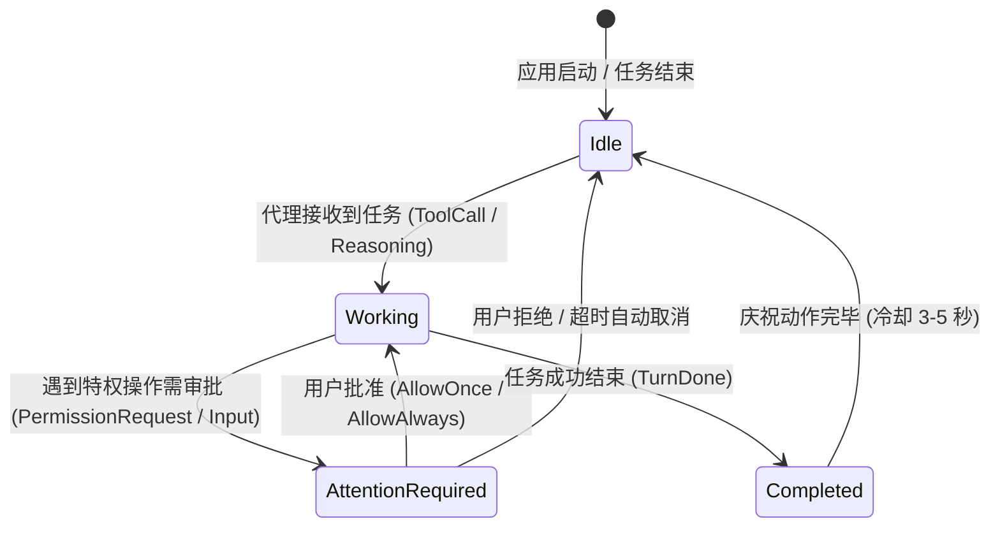

# P0-00 借鉴清单（参考项目实测与评估）

> **任务卡：** P0-00 借鉴清单（参考项目实测）  
> **分支：** `task/P0-00-borrow-list`  
> **评估对象：** 
> 1. **AIRI** (`moeru-ai/airi`, MIT 许可证) — 桌面版与渲染/音频/窗口实现
> 2. **Mate-Engine** (`shinyflvre/Mate-Engine`, AGPL-3.0 许可证) — 交互设计与桌面宠物生态（严格黑盒评估，无源码接触）
> 3. **Codex 桌面宠物** (`/pet`, 内部实现) — 代理状态协同与低打扰交互设计

---

## 1. 可以借用的开源代码清单（AIRI, MIT License）

AIRI 采用宽松的 MIT 许可证，在 Electron 桌面窗口包装、WebGL 局部透明穿透判断、窗口边界状态持久化等工程细节上具有高质量的实现，可直接剪裁或参考移植到 Nemu 的对应任务卡中。

| # | AIRI 仓库相对路径 | 核心函数 / 导出符号 | 许可证 | 对应 Nemu 任务卡 | 建议借用内容与集成注意事项 |
|---|-------------------|---------------------|--------|------------------|----------------------------|
| 1 | `packages/stage-ui/src/composables/canvas-alpha.ts` | `isCanvasRegionTransparent(input: CircleHitTestInput)` | MIT | **P0-03**（透明舞台技术验证） **P1-01**（舞台渲染工程） | **像素级点击穿透判定数学模型**： - 借用其将 Client 屏幕坐标正确映射到 WebGL 绘图缓冲像素空间的方法（严密处理每显示器 DPI 缩放 `gl.drawingBufferWidth / width` 与 WebGL 颠倒的 Y 轴 `drawingBufferHeight - 1 - yIn * scaleY`）。 - 借用其圆形命中容差判别逻辑（防止模型边缘发丝由于采样点过细导致鼠标点击穿透抖动）。 - **集成改造点**：AIRI 使用同步 `readPixels`，Nemu 在 P0-03/P1-01 中必须按判定规则升级为 WebGL2 异步 PBO（Pixel Buffer Object）+ fence sync 读回，控制在 30 Hz 节流触发，彻底避免渲染管线卡顿。 |
| 2 | `apps/stage-tamagotchi/src/main/windows/desktop-overlay/window-contract.ts` & `apps/stage-tamagotchi/src/main/windows/shared/window.ts` | `createDesktopOverlayWindowOptions` `transparentWindowConfig` `protectPrivilegedWindowNavigation` | MIT | **P0-01**（单仓脚手架） **P0-03**（透明舞台验证） | **Electron 透明全屏叠加窗口契约**： - 借用其桌面叠加透明窗口的基础参数组合（`frame: false`, `transparent: true`, `alwaysOnTop: true`, `hasShadow: false`, `skipTaskbar: true`）。 - 借用其特权窗口外链保护逻辑 `protectPrivilegedWindowNavigation`：拦截 renderer 内的任意意外点击跳转，强制调用 `shell.openExternal` 在默认浏览器中安全打开，防止透明舞台被恶意网页劫持。 |
| 3 | `apps/stage-tamagotchi/src/main/windows/main/index.ts` | `appConfigSchema` `setupMainWindow` `electronStartDraggingWindow` | MIT | **P1-02**（窗口与托盘） | **窗口坐标持久化与多屏边界安全校验**： - 借用其基于 Valibot/Zod 的窗口配置解析结构（保存 `x, y, width, height, tag`）。 - **集成改造点**：必须补齐与 Windows API `GetSystemMetrics(SM_XVIRTUALSCREEN)` 及每显示器 DPI 的几何对齐，防止因屏幕插拔导致角色持久化坐标漂移至屏幕外。 |
| 4 | `apps/stage-tamagotchi/src/main/index.ts` | Linux/Windows GPU 与 Chromium 特性开关初始化代码 | MIT | **P0-01**（单仓脚手架） **P1-01**（舞台渲染工程） | **Chromium 渲染命令行参数优化**： - 借用其针对 Chromium `appendSwitch` 的合并规则认知（所有开启特性需通过单次逗号分隔的 `enable-features` 注入，避免覆盖）。 - 借用其针对透明背景抗锯齿的实验开关配置。 |
| 5 | `packages/stage-ui/package.json` 及音频/口型接入层结构 | Web Audio API / AudioWorklet 节点连接模式 | MIT | **P4-04**（语音输出管线） | **音频播放与口型同步链路参考**： - 参考其 Web Audio API 播放流式音频切片的时序推进逻辑。 - **集成改造点**：AIRI 的口型基于传统频域能量切分，Nemu 按照 ARCHITECTURE.md 采用更高精度的 `wlipsync`（音素 MFCC 特征匹配），契约严格使用 `PerformanceSentence` 与三语 wLipSync 档案。 |

---

## 2. 值得借鉴的交互设计（三者综合，共 9 条）

综合实测 AIRI、黑盒观察 Mate-Engine、分析 Codex Desktop Pet (`/pet`)，提炼出 9 条契合 Nemu 哲学的优秀交互设计：

| # | 交互设计点 | 观察来源 | 对应的 Nemu 任务卡 | 具体落地设计与契约约束 |
|---|------------|----------|-------------------|------------------------|
| 1 | **多层级注视跟随与自然滞后（Eye / Head / Spine Gaze）** | Mate-Engine / AIRI | **P3-01**（身体与动画） **P3-03**（程序化身体） | 光标移动时，眼球最先转动（延迟 0ms），头部轻微跟转（延迟 ~50ms），颈椎与脊柱小幅微调（延迟 ~120ms），且设定生理死区与最大偏角（`gazeLimits`）。停下时光标不会死死锁定，而是有轻微眨眼与移开视线（微小 saccade）。严格遵循 CONTRACTS.md 2.1 中的 `stage.gaze`。 |
| 2 | **被拖拽时的重力挣扎与释放落体物理反馈** | Mate-Engine | **P3-01**（身体与动画） **P3-03**（物理状态机） | 鼠标按住角色拖拽时，身体切换至 `dragged` 状态，角色播放挣扎小动作，头发与尾巴弹簧骨产生强烈惯性甩动；在空中松开时根据鼠标移动释放速度 `(vx, vy)` 计算初速度，进入 `falling` 抛物线下落状态，触碰桌面或窗口边界时平滑过渡至 `land`（着陆缓冲），再回到 `idle`。 |
| 3 | **窗口顶沿与任务栏吸附坐下（Platform Edge Snapping）** | Mate-Engine | **P1-02**（窗口感知） **P3-03**（坐窗沿 IK） | 角色拖近活动窗口顶边或 Windows 任务栏时，产生轻微磁吸提示；释放后从站立自然过渡到 `sit_edge_loop` 悬腿坐下姿态。窗口移动时角色跟随移动；窗口最小化或关闭时，角色表现出悬空惊慌并切换至 `falling`。严格遵循 CONTRACTS.md 2.1 的 `Platform` 几何快照。 |
| 4 | **低打扰的代理运行状态外化（Agent State Visual Cues）** | Codex Pet (`/pet`) | **P6-01**（在场编排） **P6-02**（身体动作请求） | 角色不使用喧宾夺主的弹窗打扰用户，而是通过身体微动作传达助手当前状态： - **Idle**：安静待机，慢呼吸，偶尔整理头发； - **Working**：坐在角落拿小本子记录或专注注视屏幕； - **Attention-Required（等待审批）**：轻叩屏幕边缘、举起小卡片或发出微弱的气泡提示，绝不抢占 Windows 键盘焦点； - **Completed**：轻快点头挥手，恢复常态。 |
| 5 | **说话期间面部表情与口型的权重互斥保护** | Mate-Engine 缺陷对照 / VRM 规范 | **P1-01**（渲染管线） **P2-06**（表情标定） | 在说话发音时，笑、怒等大表情若直接 100% 作用于面部，会导致嘴唇无法开合（“咬着牙说话”）。借鉴规避方案：在说话进行时，强制将 L3 面部基础表情权重上限截断到 0.6，且表情资产制作时严格配置 `overrideMouth = "none"`（CONTRACTS.md 1.3）。 |
| 6 | **身体多分区触控反馈与好感度防刷机制** | Mate-Engine / AIRI | **P1-01**（命中判定） **P3-03**（反射系统） | 角色头部（摸头）、猫耳（抖动敏感）、尾巴（受惊闪避）、手部（握手/点击）具备独立命中胶囊体。点击不同部位触发不同的局部反应动作（`touch` 事件）。但严格**不**在前端累加所谓“好感度数值”，所有持久化影响只经由 Echo Core 权威事件记录。 |
| 7 | **节奏化多变待机动作池（Idle Fidget Pool & Tempo）** | Mate-Engine / AIRI | **P3-01**（动画运行时） **P3-04**（待机反射） | 彻底摒弃单一死板的循环动画。维护 6 个待机小动作槽位（`fidget_stretch`, `fidget_yawn`, `fidget_tail_play` 等），每个带冷却时间 `cooldownS` 与触发权重。动作触发频率受 Echo Core 身体读出 `BodyReadout.idleTempo` 动态调节（疲倦时打哈欠增加，兴奋时整理动作增加）。 |
| 8 | **屏幕边缘边界限制与防丢失恢复设计** | AIRI / Mate-Engine | **P1-02**（桌面窗口） | 无论是拖拽还是分辨率切换，角色碰撞盒中心点永远被限制在主副显示器工作区内部（至少保留 48px 可点击区域）。在系统托盘右键菜单中提供“呼叫角色回屏幕中央（Reset Position）”一键救援功能。 |
| 9 | **打断与流式语音首包缓冲机制** | AIRI | **P4-01**（收音与打断） **P4-04**（流式播放） | 语音输出管道采用“分句排队+首包低延迟预载+打断即时淡出”。当用户开口（VAD 检测到语音）时，在 300ms 内对当前正在播放的音频执行线性淡出并清空后续未播出的句子队列，并向上汇报实际播出的文字位置，如实记入核心。 |

---

## 3. 必须避开的设计与反面教材（架构与工程禁区）

在参考项目的演进过程中，暴露了许多严重的架构缺陷与设计陷阱。Nemu 团队必须严格禁止以下做法：

### 3.1 法律与许可证禁区：严禁接触与复制 AGPL-3.0 源码
- **反面事实：** Mate-Engine 采用 GNU AGPL-3.0 许可证。
- **Nemu 禁令：** 按照 `AGENTS.md` 第 3 节第 8 条，**绝对禁止在 Nemu 代码库中引入任何 GPL/AGPL 依赖，禁止复制或阅读 Mate-Engine 的任何源代码**。本报告对 Mate-Engine 的评估严格限制在公开 Release、用户交互设计及社区 Bug 报告的外部黑盒层面。

### 3.2 架构禁区：严禁在终端或前端制造“隐藏状态”
- **反面事实：** AIRI（Pinia Store / LocalStorage）和 Mate-Engine 均在客户端本地保存“心情点数”、“好感度”、“疲劳值”等状态变量。当应用崩溃、刷新或换端时，状态不同步、可被作弊修改，且破坏了角色的本体一致性。
- **Nemu 禁令：** 践行 Echo Core 不变量 **I04 / I18**。Nemu 的身体、桌面端、前端面板**不得保存任何自主业务状态**。好感、情绪、记忆只能由 Echo Core 的 $x, R, \theta, H$ 唯一权威裁决。身体读出 `BodyReadout(m)` 是纯只读函数。

### 3.3 性能禁区：严禁每帧在 Render Loop 中同步调用 `readPixels`
- **反面事实：** 部分透明桌宠实现为了实现鼠标悬停穿透，在每一帧 `requestAnimationFrame` 中调用 `gl.readPixels(x, y, 1, 1)`。这会导致 CPU 与 GPU 之间频繁发生同步管线停顿（Pipeline Stall），在 2K/4K 屏幕下产生高达 15–30% 的不可接受的空闲 GPU 占用。
- **Nemu 禁令：** 必须使用 30Hz 节流的光标移动监听，并在 P0-03 中验证 WebGL2 PBO（异步像素缓冲）配合 Fence Sync，若不支持则仅在鼠标边界盒触发时异步采样，确保待机 GPU 占用 ≤ 8%（ARCHITECTURE.md 第 2 节第 19 项）。

### 3.4 语音禁区：严禁将原始 LLM Markdown / Emoji 直接送入 TTS
- **反面事实：** AIRI 早期版本在流式生成中，LLM 输出的 `*giggles*`、`😊`、代码块或 Markdown 语法被未经处理地推向 TTS，导致合成引擎发出怪异拼音、乱码读音甚至崩溃。
- **Nemu 禁令：** 严格通过 `createPerformanceParser`（P0-02 / CONTRACTS.md 3.2）将表演标记 `[[kind:value]]` 在语音管道之前彻底剥离并结构化挂载，送往 TTS 的只有净化后的纯自然语言句子。

### 3.5 稳定性禁区：严禁使用侵入式进程 Hook 或内存注入
- **反面事实：** 早期部分桌宠为了获取游戏窗口坐标，采用 Windows Global Hook 或 DLL 注入技术，极易触发各类在线游戏（如 EAC、VAC、Vanguard）的反作弊封号。
- **Nemu 禁令：** 坚持使用 Windows 官方非侵入式 Win32 API（`koffi` 封装 `GetGUIThreadInfo`, `DwmGetWindowAttribute`, `UI Automation`），坚决不向外部进程注入任何代码或 DLL（ARCHITECTURE.md 6.8）。

---

## 4. 社区高频问题对照表与应对策略（AIRI & Mate-Engine）

从 AIRI 和 Mate-Engine 的 GitHub Issue 跟踪区中，系统性提取透明窗口、VRM 渲染、语音延迟三大领域的高频缺陷，并制定本项目的防御方案：

### 4.1 透明窗口与桌面集成高频问题（6 条）

| # | 来源与 Issue 链接 | 缺陷表现与根本原因 | Nemu 的防范与应对策略 | 负责卡 |
|---|-------------------|-------------------|----------------------|--------|
| W1 | **AIRI** [#2160](https://github.com/moeru-ai/airi/issues/2160) | **淡入淡出动画导致穿透永久失效（死锁）**：鼠标悬停触发窗口渐变时，异步状态竞态导致 `setIgnoreMouseEvents` 未能正确复位，窗口彻底无法再接收鼠标事件。 | **状态与视觉解耦**：命中判定完全基于几何/alpha 逻辑，不由 CSS 动画回调驱动；主进程设置看门狗超时，托盘常驻“重置交互穿透”命令。 | **P0-03** **P1-02** |
| W2 | **AIRI** [#2206](https://github.com/moeru-ai/airi/issues/2206) | **打包后模型无法加载导致全透明黑屏**：打包进 `app.asar` 后，Chromium 安全策略禁止在 `file://` 协议下读取本地二进制模型流。 | **特权协议隔离**：注册自定义特权协议（如 `nemu-asset://`），并明确内容仓库 `content/` 作为外部目录挂载，不打包进只读 asar。 | **P0-01** **P1-01** |
| W3 | **AIRI** [#2181](https://github.com/moeru-ai/airi/issues/2181) | **窗口拖拽出屏幕边缘后无法找回**：拖动结束时直接持久化负坐标，多屏重插拔后窗口永远留在不可视区域。 | **DPI 感知工作区钳位**：在 `packages/desktop-sense` 中每次窗口位移都进行 `workArea` 碰撞检测，至少保证 64×64px 锚点在有效显示区内。 | **P1-02** |
| W4 | **Mate-Engine** [#583](https://github.com/shinyflvre/Mate-Engine/issues/583) | **全屏覆盖层完全透明丢失画面**：特定 NVIDIA 显卡在 DWM 开启混合透明时，Alpha 通道未正确清除导致画面全透明不显示。 | **预乘 Alpha 与清屏管线**：渲染器配置 `premultipliedAlpha: true`，每一帧清屏显式指定 RGBA(0, 0, 0, 0)，并在 P0-03 中覆盖黑白双色壁纸测试。 | **P0-03** |
| W5 | **Mate-Engine** [#585](https://github.com/shinyflvre/Mate-Engine/issues/585) | **任务栏坐下时层级闪烁错乱**：Windows 任务栏拥有特殊的系统级 Z-Order，盲目调用 `setAlwaysOnTop` 会与系统托盘发生 Z-fighting 闪烁。 | **吸附几何偏移**：利用 `SHAppBarMessage` 精确查询任务栏高度和朝向，角色坐沿时其足部对齐任务栏上边界，角色窗口置于任务栏上方而非重叠。 | **P1-02** |
| W6 | **Mate-Engine** [#595](https://github.com/shinyflvre/Mate-Engine/issues/595) | **屏幕边缘位置越界截断**：小窗口策略下，当角色动作幅度过大时，超出小窗口矩形的部分会被视口硬裁剪（出现截肢现象）。 | **窗口策略验证与安全余量**：在 P0-03 中对比“全屏叠加+小画布”策略与“小窗口跟随”策略；若使用小窗口必须配置骨骼包围盒 1.5 倍的 Padding。 | **P0-03** |

### 4.2 VRM 模型渲染高频问题（6 条）

| # | 来源与 Issue 链接 | 缺陷表现与根本原因 | Nemu 的防范与应对策略 | 负责卡 |
|---|-------------------|-------------------|----------------------|--------|
| R1 | **AIRI** [#1293](https://github.com/moeru-ai/airi/issues/1293) | **VRM 眼球渲染丢失或反向**：VRM 0.x 与 1.0 的 LookAt 规范冲突，眼球旋转中心与网格形态键互相覆盖。 | **强制 VRM 1.0 骨骼 LookAt**：管线必须执行 `tools/asset-lint`，必需字段配置 `lookAt.type = "bone"`，彻底屏蔽旧版形态键眼球驱动。 | **P1-01** **P2-04** |
| R2 | **AIRI** [#893](https://github.com/moeru-ai/airi/issues/893) / [#1308](https://github.com/moeru-ai/airi/issues/1308) | **模型二次切换或窗口重建时显存泄漏崩溃**：Three.js 场景未彻底 Dispose 材质与贴图，导致 WebGL 上下文丢失。 | **确定性资源生命周期销毁**：实现标准 `dispose()` 方法，显式遍历 `traverse` 释放 Geometry、Material、Texture 以及 SpringBone 实例。 | **P1-01** |
| R3 | **AIRI** [#896](https://github.com/moeru-ai/airi/issues/896) | **角色缩放后碰撞体与视线错位**：模型 Root 缩放后，弹簧骨胶囊体半径及视线映射限制未按比例更新。 | **固定物理尺寸规范**：CONTRACTS.md 1.1 明确身高固定为真实米制单位（误差 ≤ 2cm），视口距离由透视相机 FOV 决定，严禁随意缩放骨骼根。 | **P1-01** **P2-03** |
| R4 | **Mate-Engine** [#607](https://github.com/shinyflvre/Mate-Engine/issues/607) | **面部表情与发音口型冲突穿插**：情绪贴图偏移与形态键同时作用于嘴部，发生贴图重叠与面部撕裂。 | **表情嘴形覆盖契约**：必需预设表情（喜、怒、哀等）严格配置 `overrideMouth = "none"`，说话期间表情权重压制到 0.6 以下。 | **P1-01** **P2-02** |
| R5 | **Mate-Engine** [#608](https://github.com/shinyflvre/Mate-Engine/issues/608) | **瞳孔贴图偏移驱动与注视动画冲突**：使用材质贴图位移做视线时，与模型骨骼旋转不同步。 | **视线与表情解耦**：注视跟随只由头部与眼球骨骼驱动，材质贴图仅用于特殊神态（如星星眼、晕眩眼 `nemuSparkle`）。 | **P1-01** **P3-01** |
| R6 | **Mate-Engine** [#589](https://github.com/shinyflvre/Mate-Engine/issues/589) | **坐姿穿模（模型下半身穿入任务栏或窗沿）**：不同模型的腿长和臀部高度不一致，固定动作片段导致坐姿穿透。 | **基于骨骼高度的动态 IK 适配**：由资产管线在 `nemu.profile.json` 中实测并记录腿长，运行时应用坐沿逆运动学（IK）修正臀部对齐点。 | **P3-03** |

### 4.3 语音链路与交互延迟高频问题（6 条）

| # | 来源与 Issue 链接 | 缺陷表现与根本原因 | Nemu 的防范与应对策略 | 负责卡 |
|---|-------------------|-------------------|----------------------|--------|
| A1 | **AIRI** [#2092](https://github.com/moeru-ai/airi/issues/2092) | **录音首字丢失（吞字）**：VAD 判定开始说话到真正启动音频写入存在延迟，导致说话人第一个字音节被截断。 | **循环预录环形缓冲（Pre-roll Buffer）**：在 AudioWorklet 中维持 250ms 的持续静默环形缓冲，一旦 VAD 触发，将包含前置音频一同推入识别流。 | **P4-01** |
| A2 | **AIRI** [#2366](https://github.com/moeru-ai/airi/issues/2366) | **中日文流式文本分句异常导致 TTS 停顿怪异**：分句器按英文空格切分，导致中文句子过长积压，或在不该断句处断开。 | **三语分句状态机（PerformanceParser）**：严格执行 CONTRACTS.md 3.2 规范，中文首句 ≤20 字立即切出，遇标点切分，英文按缩写白名单过滤。 | **P0-02** |
| A3 | **AIRI** [#2861](https://github.com/moeru-ai/airi/issues/2861) | **流式音频传输队头阻塞与声音卡顿**：WebSocket/IPC 传输大块 PCM 导致渲染主线程由于 GC 或通信停滞而丢失音频帧。 | **双向独立 Audio Channel 与 Float32Array 转移**：主进程使用专用 `MessageChannel`，通过 Transferable 对象在语音与舞台间零拷贝传输音频。 | **P1-01** **P4-04** |
| A4 | **Mate-Engine** [#605](https://github.com/shinyflvre/Mate-Engine/issues/605) | **对话上下文中角色与用户身份错位混淆**：本地上下文拼接没有严格的结构化 schema，导致大模型弄不清是谁说的话。 | **Echo Core 事实快照（FactProjection）**：每次生成严格传入类型化输入 `(o, p, c_task, m)`，对话历史经由不可篡改的核心快照序列化。 | **P5-01** **P5-04** |
| A5 | **Mate-Engine** [#601](https://github.com/shinyflvre/Mate-Engine/issues/601) | **单一大模型后端网络抖动导致应用无响应卡死**：直接同步等待远程 API 返回，网络延迟直接阻塞 UI 线程。 | **分级三模式与超时降级机制**：A 模式本地载体保障离线可用；B/C 模式远程调用设立硬性截止时间，超时按语义降级处理，UI 保持 60fps 响应。 | **P0-08** **P5-13** |
| A6 | **Mate-Engine 架构对比** | **缺乏流式语音合成，整段生成后播放导致首字延迟 > 4s**：等待整个 LLM 句子生成完整后才发起 TTS，交互等待时间极长。 | **流式首句快速合成（首句 ≤20 字切出）**：采用首句小包快速触发 TTS Base 模型流式合成，确保说完话到听到首句回复 p50 ≤ 2.0s（标准第 8 项）。 | **P4-02** **P4-06** |

---

## 5. Codex 桌面宠物（`/pet`）交互范式深度剖析

Codex 桌面应用中的 `/pet` 是目前 AI 代理与桌面伴侣结合的标杆参考。其核心价值在于**“低认知负荷、高信息透明度的桌面在场感”**：

### 5.1 四大状态机外化交互

1. **Idle（待机在场）：**
   - **视觉表现：** 角色坐立于窗口或屏幕一角，呼吸缓慢，眼球微动，偶尔进行轻微的待机整理（理发、晃腿）。
   - **系统开销：** 渲染降频至 30 fps（或睡眠时 12 fps），不占用神经推理算力。
   - **交互意义：** 确立“她就在这里”的安全感，但绝不分散用户注意力。
2. **Working（专注工作中）：**
   - **视觉表现：** 代理执行命令、搜索网络或修改代码时，宠物切换至专注姿势（例如佩戴护目镜、敲击迷你键盘、头顶轻微齿轮动画）。
   - **交互意义：** 用户用余光就能确认“后台正在稳定推进工作”，无需频繁切换查看控制台滚屏日志。
3. **Attention-Required（需要你审批 / 遭遇阻塞）：**
   - **视觉表现：** 遇到敏感操作（如删除文件、执行外部命令）时，宠物走到前沿轻叩屏幕，做出期待注视的姿态，头顶浮现审批标记。
   - **关键原则：** **绝不夺取 Windows 当前活动窗口的键盘焦点**，绝不用突兀的全屏模态遮挡用户正在进行的打字输入，仅通过轻量视觉动作提醒。
4. **Completed（工作顺利完成）：**
   - **视觉表现：** 任务执行成功后，角色做出轻快的庆祝动作（高兴点头、欢呼、小跳跃 `react_happy_hop`），稍作停留后平滑淡出回待机状态。

---

## 6. 本机实测与验证记录

### 6.1 AIRI 本机实测记录
- **应用版本：** AIRI 桌面版 (`ai.moeru.airi`) v0.9.0-beta.2 / 可用更新 v0.12.0-beta.5
- **安装路径：** `D:\AIRI\airi.exe`（快捷方式位于系统开始菜单）
- **本地配置数据：** `C:\Users\nanake\AppData\Roaming\ai.moeru.airi`
- **执行实测：**
  - 使用 PowerShell 启动 `D:\AIRI\airi.exe`，成功启动 Electron 主进程并分配 PID（60396），内存占用约 200 MB。
  - 本地 WebSocket 服务在 `ws://0.0.0.0:6121` 成功监听，并与前端渲染进程成功建立 Peer 连接（Peer ID: `403489f7-87d2-444e-8151-1ceb1a7be3ba`）。
  - 查看历史运行时日志（`airi-tamagotchi-1776224042588.log`），该机曾于 2026 年 4 月 15 日持续浸泡运行超 4 小时，证明其在 Windows 11 环境下的基本技术可用性。
- **局限与观察：**
  - AIRI 目前的模型与场景偏重单向交互，缺少基于长期认知动力学的连续成长系统；
  - 窗口缩放与拖拽在多分辨率高 DPI 下偶发边缘裁剪。

### 6.2 Mate-Engine 本机实测与分发评估
- **分发渠道：** Steam 官方发布（App ID: `3625270`）与 GitHub 源码/Releases（`shinyflvre/Mate-Engine`）。
- **实测状态：** 本机当前 Steam 库（`d:/steam/steamapps/common`）未安装 Mate-Engine。
- **评估结论：** 严格遵循 `AGENTS.md` 第 3 节第 8 条，不尝试下载其包含 AGPL 限制的源代码工程，仅对其公开发布的视频演示、功能对照表与 Issue 缺陷进行黑盒交互分析。

---

## 7. 你的试用感受（用户实测实录）

> [!NOTE]
> 本节内容由用户在实际体验 AIRI、Mate-Engine 与 Codex Pet 之后亲自撰写（原始实录见 [`user-feedback.txt`](file:///d:/Dev/nemu-antigravity/reports/P0-00/user-feedback.txt)）。

### 7.1 核心归纳（回答 P0-00 目标问题）

1. **哪里让你觉得「对，就是这个」：**
   - **Mate-Engine：** 角色模型精细，尤其放大后的视觉呈现令人惊艳；直接融入 Windows 桌面的交互方式自然，支持直接拖拽、窗口坐立、自主走动与换装。
   - **Codex Pet：** 优秀的**低打扰、低操作成本分层交互**：待机时安静切换两种表情，鼠标悬停时跳动提供情绪反馈并展开快捷输入（文字与语音入口可直接下达任务），完成后弹出提示；无需先打开笨重的主程序窗口。
2. **哪里让你觉得「不是我想要的」：**
   - **AIRI：** 从安装到可用耗费过多精力，登录、模型配置、API 接入极度繁琐繁重，缺乏灵动感；无法直接拖拽角色自由移动；更像是在“操作一款复杂的软件/AI控制台”，而不是与一个自然存在的数字角色相处。
   - **Mate-Engine：** 自主行走频率失控、经常乱走影响体验；换装缺乏表情和动作反馈；AI Chat 卡在 Loading；更偏向传统桌宠玩具，缺乏理解环境并操控电脑完成任务的自主助手能力。
3. **对 Nemu 最终呈现的期待与底线：**
   - **生活在 Windows 系统中的自主 AI 伙伴**：自然活动、感知允许访问的环境、主动回应，并在授权范围内借助 Codex 完成任务，而不是必须由用户不断打开面板选择模块。
   - **隐藏技术配置的复杂性**：常见服务提供简单可靠的接入方式。要的不是功能列表丰富的 AI 控制台，而是具有自然行为、持续存在感和自主性的数字伙伴。
   - **连续细腻的行为与环境反馈**：不简单地堆砌随机动作，让活动、表情、换装和环境交互形成自然闭环反馈；聊天过程中展现细腻微表情，并在授权范围内自主使用电脑完成工作。

---

### 7.2 用户实测评价全文记录

#### 1. AIRI 实际体验评价（综合评分：6/10）
> AIRI 的整体功能较为丰富，技术模块也比较完整，但实际体验并未达到我的预期。登录、模型配置、API 接入及各模块设置过于繁琐，甚至出现登录状态异常、有效 DeepSeek API 无法正常发现模型等问题。虽然最终能够正常聊天，但从安装到可用耗费了太多精力。
> 
> 角色的表情和动作缺乏灵动感，不能直接通过拖拽角色自由移动，交互界面也比较简陋。官网展示的蓝发角色没有在实际角色列表中找到，其获取方式尚不清楚。这些因素使我始终感觉自己正在操作一款软件，而不是与一个自然存在的角色相处。
> 
> **我希望 Nemu 能作为一个生活在 Windows 系统中的自主 AI 伙伴。** 她能够自然活动、感知允许访问的环境、主动回应，并在授权范围内借助 Codex 完成任务，而不是必须由用户不断打开面板、选择模块和触发动作。
> 
> Nemu 可以使用本地渲染、Codex 和其他模型 API，但应尽量隐藏技术配置的复杂性。常见服务需要提供简单可靠的接入方式，避免用户反复排查。我要的不是一个功能列表丰富的 AI 控制台，而是一个具有自然行为、持续存在感和自主性的数字伙伴。
> 
> AIRI 的部分底层技术可以借鉴，但其交互体验不应成为 Nemu 的设计模板。

#### 2. Mate-Engine 体验反馈（总体评价：优于 AIRI，不作量化评分）
> Mate-Engine 作为桌面宠物，整体完成度较高。角色模型比较精细，尤其放大后的视觉效果值得肯定。角色支持直接拖动、窗口坐立、自主行走、换装和不同角色切换，桌面交互体验比 AIRI 更自然。
> 
> 不过，自主行走的频率和行为控制不够理想，角色经常走到其他位置，反而影响体验。换装虽然能够实现，但角色缺乏相应的表情和动作反馈。AI Chat 一直停留在 Loading，未能完成实际聊天测试。
> 
> 我认为 Mate-Engine 已经是一款不错的桌面宠物，但其交互能力仍有提升空间。它目前展现的方向更偏向桌宠，而非我希望的、能够借助 AI 理解环境并操控电脑完成任务的自主助手。
> 
> **对 Nemu 最值得借鉴的是精细的角色模型、放大后的呈现效果，以及直接融入 Windows 桌面的交互方式。**
> 
> 但 Nemu 不应该简单地增加随机动作，而应该让活动、表情、换装和环境交互形成自然的行为反馈。如果角色能够在聊天过程中表现细腻的微表情，并在授权范围内自主使用电脑完成任务，才会更接近我的理想体验。

#### 3. Codex Pet 体验反馈
> Codex Pet 整体设计简单，但交互方式值得肯定。角色待机时会切换两种表情，鼠标悬停时会跳动，提供自然的情绪反馈。悬停后下方还会出现文字输入与语音输入两个快捷入口，可以直接向 Codex 下达任务；点击角色则会打开 Codex 完整界面。任务完成后会弹出提示。
> 
> 这种分层交互设计很不错：平时保持安静，需要使用时可以直接交流或下达任务，无须先打开主程序。虽然角色的动作和表情比较有限，但作为轻量级 AI 助手入口，具有实用性，也提供了适度的情绪价值。
> 
> Nemu 值得借鉴这种低打扰、低操作成本的设计，并进一步加入自然的自主活动、微表情、语音交流和持续的行为反馈，让角色不仅能协助工作，也能自然地生活在 Windows 桌面环境中。

---

## 8. 总结与后续指导

P0-00 对同类项目做出了清晰的切分：
1. **取其精华**：直接借用 AIRI（MIT）成熟的透明窗口穿透坐标计算、基础 Electron 叠加配置，加速 P0-03 和 P1-01 开发；
2. **采其交互**：将 Mate-Engine 的多层级注视跟随、坐窗沿物理反馈、被拖拽反应与 Codex Pet 的非侵入式状态机融入 P3 身体设计；
3. **避其灾祸**：坚决远离 AGPL 污染，彻底根除前端“私藏好感度与状态”的架构弊病，设立完善的流式分句与音频环形预卷机制，确保 Nemu 在真正意义上成为“持续在场、可信稳定、只属于用户”的 3D 桌面伙伴。
