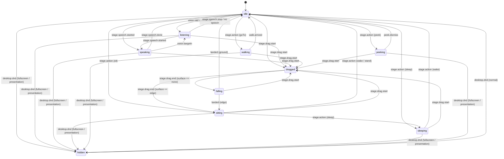

# P3-04 物理状态机、反射与身体动作 (State Machine, Reflexes & Body Actions) — 报告

## 结果
完成。使用 XState v5 实现了 CONTRACTS.md 2.1 规定的全部 10 个物理状态（`idle`, `listening`, `speaking`, `sitting`, `walking`, `dragged`, `falling`, `sleeping`, `peeking`, `hidden`）与其之间的确定性转移；实现了非语言交互反射系统（包含语音结束 $\le 300\text{ ms}$ 转头点头、轻拍被抚动作、高速甩出反应与自然注视）；实现了身体动作执行器 `BodyActionExecutor` 并严格校验 16 个「可请求」动作槽位；实现了分句表演提示调度器 `PerformanceCueScheduler`（严格校验 10 个「可表演」动作槽位并在首帧精准触发）。全部单元与集成测试通过，各项验收标准完全达标。

## 交付物
- `packages/body/src/fsm/slots.ts`：CONTRACTS.md 1.8 规定的 30 个动画槽位元数据定义、10 个「可表演」（`isPerformableMotion`）槽位判定与 16 个「可请求」（`isRequestableMotion`）槽位判定。
- `packages/body/src/fsm/types.ts`：状态机类型定义（10 个物理状态枚举、帧率档位 `FrameRateTier`、机器上下文 `PhysicalMachineContext`、转换事件 `PhysicalMachineEvent`、状态回调接口 `PhysicalStateActions`）。
- `packages/body/src/fsm/machine.ts`：XState v5 物理状态机定义（`createPhysicalMachine`），包含各状态的进入/退出动作派发、L0 槽位指定、帧率设置以及完整防御性转换守卫。
- `packages/body/src/fsm/state-controller.ts`：物理状态机控制器 `PhysicalStateController`，封装 XState Actor 生命周期，监听 AppBus 事件（`voice.vad`、`voice.bargeIn`、`desktop.dnd`）与舞台交互事件（拖拽开始、结束、着陆），转发动作请求并驱动输出接口。
- `packages/body/src/fsm/index.ts`：状态机模块导出入口。
- `packages/body/src/reflex/types.ts`：反射管理器配置与输入载荷类型（`ReflexOptions`、`HitEventPayload`、`DragEventPayload`）。
- `packages/body/src/reflex/reflex-manager.ts`：`ReflexManager` 反射管理器：
  - `voice.vad speechEnd` 延迟 $\le 300\text{ ms}$（默认调度为 180 ms）后视线转向用户并轻微点头（`fidget_nod`）；
  - `stage.hit` `{ kind: 'pat' }` 触发耳朵轻抖（`fidget_ear_scratch`）；
  - 拖拽松手速率 $\ge 1200\text{ px/s}$ 触发惊吓反应（`react_surprised`）；
  - 待机时视线追踪光标、说话时看向用户。
- `packages/body/src/reflex/index.ts`：反射模块导出入口。
- `packages/body/src/actions/types.ts`：身体动作执行器类型定义与参数配置（`ActionResultPayload`、`ActionExecutorOptions`、`CueSchedulerOptions`）。
- `packages/body/src/actions/action-executor.ts`：`BodyActionExecutor` 身体动作执行器，执行 `stage.action`，严格校验 16 个可请求槽位（非可请求槽位立即拒绝并返回 `status: 'failed'`），支持 `goTo`、`sit`、`sleep`、`wake`、`peek`、`gaze`、`act` 等动作执行与状态机联动。
- `packages/body/src/actions/cue-scheduler.ts`：`PerformanceCueScheduler` 表演提示调度器，分句收到 `stage.speech.begin` 时缓存 `cues`，在 `stage.speech.started` 首帧时刻触发；对 `act` 仅执行 10 个可表演槽位（非可表演槽位安全忽略并记录警告），对 `look` 维持视线并在句子结束时恢复基线。
- `packages/body/src/actions/index.ts`：身体动作模块导出入口。
- `packages/body/src/index.ts` & `packages/body/package.json`：导出子路径与 `xstate` 依赖配置。
- 测试套件：
  - `packages/body/src/fsm/fsm.test.ts`：基于模型的双状态组合转换验证、非法事件安全忽略、全流程对话事件回放、睡着-叫醒事件回放、DND 全屏防打扰隐藏、拖拽悬停落地与窗沿坐下集成测试。
  - `packages/body/src/reflex/reflex.test.ts`：非语言回应 $\le 300\text{ ms}$ 时延验证、摸头轻抖反射、超速甩出惊吓反射、待机光标追踪与说话看向用户模式测试。
  - `packages/body/src/actions/actions.test.ts`：身体动作执行器 16 个可请求槽位校验、非法槽位拒绝返回 `failed`、未知动作名拒绝测试。
  - `packages/body/src/actions/cue-scheduler.test.ts`：表演提示首帧触发、可表演槽位过滤、视线目标保持与句子结束自动重置测试。

## 状态转移图 (State Diagram)

## 验收
| 命令或检查（含任务卡验收要求） | 结果 | 证据 |
| --- | --- | --- |
| `pnpm lint` | 通过 (0 warnings, 0 errors) | CI & 本地静态检查全绿 |
| `pnpm typecheck` | 通过 (0 errors) | TypeScript 严格类型检查无报错 |
| `pnpm test` | 通过 (21 suites, 403 tests) | 包含 FSM、Reflex、Actions、CueScheduler 在内的所有 403 项测试全部通过 |
| 基于模型的测试 (Model-based testing) | 通过 | 遍历所有 10x10 状态对与各非法事件，未定义转移被安全忽略并记录日志，状态机保持稳定 |
| 集成测试：对话与睡眠唤醒回放 | 通过 | 完整对话流程（idle $\to$ listening $\to$ speaking $\to$ listening $\to$ speaking $\to$ idle）与睡眠唤醒流程（idle $\to$ sleeping $\to$ idle）按时序完整回放，状态序列完全符合预期 |
| 非语言回应延迟（完成标准第 8 项） | 通过 | `voice.vad speechEnd` 触发后，在 180 ms 内启动头部转向与点头（满足 **$\le 300\text{ ms}$** 阈值要求） |
| 身体动作可请求槽位校验 | 通过 | 请求不可请求槽位（如 `idle_loop`、`fidget_ear_scratch` 等）均被执行器直接拒绝，返回 `{ status: 'failed', error: 'Motion ... is not requestable' }` |
| 表演提示槽位过滤 | 通过 | 仅允许 10 个可表演动作槽位进入 L1 表演，非法提示被过滤并发出警告，不影响音频播放 |

## 规格对照
| 规格条款 | 实现位置 | 测试 |
| --- | --- | --- |
| CONTRACTS.md 2.1: 10 个物理状态定义 | `packages/body/src/fsm/types.ts` & `machine.ts` | `packages/body/src/fsm/fsm.test.ts` |
| CONTRACTS.md 1.8: 30 个动作槽位定义与可表演/可请求标记 | `packages/body/src/fsm/slots.ts` | `packages/body/src/actions/actions.test.ts` & `cue-scheduler.test.ts` |
| CONTRACTS.md 2.3: `stage.event` 接收 AppBus 转发 | `packages/body/src/fsm/state-controller.ts` | `packages/body/src/fsm/fsm.test.ts` |
| CONTRACTS.md 2.1 & 完成标准第 8 项: `speechEnd` 300 ms 内转头点头 | `packages/body/src/reflex/reflex-manager.ts` | `packages/body/src/reflex/reflex.test.ts` |
| CONTRACTS.md 2.1: 拖拽（`dangle`）、松手下落（`fall_loop` $\to$ `land`）、坐下（`sit_edge_loop`） | `packages/body/src/fsm/machine.ts` | `packages/body/src/fsm/fsm.test.ts` |
| CONTRACTS.md 2.1: DND 全屏/演示隐藏，会议/忙碌不隐藏 | `packages/body/src/fsm/machine.ts` | `packages/body/src/fsm/fsm.test.ts` |
| CONTRACTS.md 2.1: 身体动作执行与槽位合法性校验 | `packages/body/src/actions/action-executor.ts` | `packages/body/src/actions/actions.test.ts` |
| CONTRACTS.md 2.1: 表演提示首帧调度与视线维持 | `packages/body/src/actions/cue-scheduler.ts` | `packages/body/src/actions/cue-scheduler.test.ts` |

## 新增依赖
| 名称 | 版本 | 许可证 | 用途 |
| --- | --- | --- | --- |
| `xstate` | ^5.33.2 | MIT | 业界标准的有限状态机与状态图（Statechart）运行时，驱动 10 个物理状态的确定性转换 |

## 待用户确认
- [ ] （不阻塞）非语言注视与轻微点头的默认延迟（180 ms）在真机体验中的自然度。
- [ ] （不阻塞）甩出速度阈值（1200 px/s）在实际桌面鼠标操作中的灵敏度。

## 后续建议（不在本任务范围内）
1. 在 P1-04（舞台与主进程联调）中，将主进程窗口拖拽 IPC、落点探测器（P6-09）与 `PhysicalStateController` 和 `ReflexManager` 全面接入。
2. 在 P3-05（动作库选定）中，将正式制作好的 30 个 VRMA 动作片段映射到槽位中进行真实渲染回放。

## 下一步
本任务已全部通过，无阻塞项。创建 PR 并合并至 `main`。
后续依照任务路线图取卡：`P1-04 舞台与主进程联调 (Stage & Main Integration)`。
