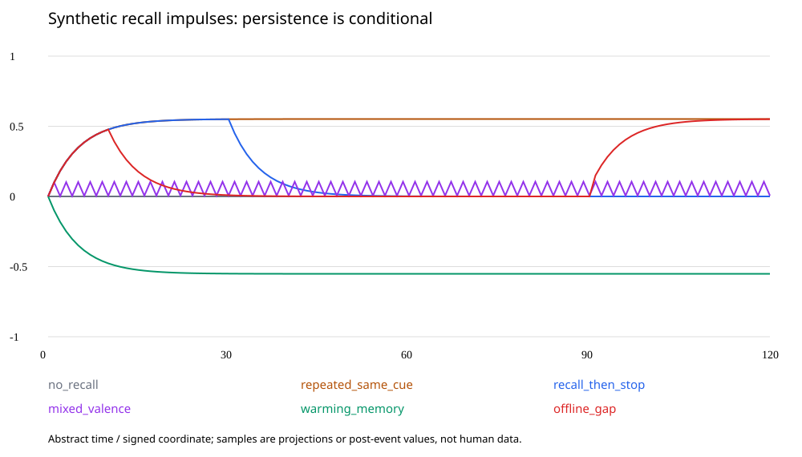

# 思念、内在事件与 Echo Core v2.0 — 设计研究

## 当前状态

研究完成，建议供用户决定；不是任务卡交付、正式 ADR、实现授权或产品验收。研究日期：2026-10-24（Australia/Perth）。新增文件全部位于本目录，未修改规格、契约、任务卡、配置或产品代码；未打开正式/排练存储，未运行模型、浏览器、桌面应用或重负载，也未改变用户级或系统级设置。需要未来登记的编号均为「待定」。

读取远端 main 的固定基线为 **0b5412e95caab447c70148c473e544dbab28c57c**。PR #73 的研究材料另固定为 **25e8474958c7ccd9d0d37266a881c8df733f7058**，已核对「审查结论：通过」评论；读取时仍为 open、draft、未合并。审查通过不等于缺席选项或规律已获用户批准。引用位置及来源哈希见 [SOURCES.md](SOURCES.md)、[source-manifest.json](source-manifest.json)。

**环境差异：** 本会话是 Linux 云端，没有挂载 Windows D 盘，也没有用户机器的执行通道。HTTPS git 读取因无凭据失败；通过已连接 GitHub API 读取固定提交、建立分支与提交研究。未执行成功 git fetch / git worktree add，**未建立用户指定的 D:\Dev\nemu-wt\longing-study**。本地研究暂存目录为 /workspace/scratch/2c4129af8a1f/longing-study，不冒充 Windows worktree。远端目标分支为 codex/longing-study；这项本地目录要求仍未完成。

原文核对后的几个关键纠正：

| 用户背景中的概括 | 原文及本研究的判定 |
| --- | --- |
| 自己的念头不算经历/证据 | 「她是谁」第 3 点确实写了“不算经历”；EV3 精确禁止的是把自己的叙述当证据。H 本来就包含自身行动/记录，**发生过一场回想**与**回想内容是外部事实**必须分开。 |
| 没有事件，什么都不变 | 推论 5 的标题宽泛，证明对象实际是 π；LP5/AC2-05 明确是无新证据时 R、θ 不变。§2.4、§6 明确允许 x 随时间松弛；静息点是 (b,0)，不保证心理意义上“平静”。 |
| 尚无回想机制 | §6 最后一行已有“吻合的情境、回想”，但没有给出内在触发、来源类型、事务与重放的闭合定义。可作为设计入口，不能当作已实现或已授权。 |
| 主动边界不含向内行动 | §9.4、CONTRACTS §8、config/opportunities.json 确实没有回想种类。P5-20 仍要求模型在 m 下提议、固定上界 thinning、记录实际随机数与判定。 |
| 只需解决缺席 a/b/c | a/b/c 决定缺席如何获得认识论资格；自主回想决定内部计算能否发生。两者是不同轴，不能互相替代。 |

**主要结论：** Claude 第 1、2 点是可行的最小起点，但「R、θ 才是她是谁」「越想必然越想」「关机就是人的睡眠」均需纠正。推荐研究**带来源类型的内在事件，经已有 R 读出驱动 x**；保留“不把想象当外部证据”，不给重复回想新增关系证据权重。长期内部学习另列明确选择，不能声称已完整复现人的心理。

## 1. 先问一个人会怎样

这里的“思念”至少包含对特定对象的接近动机、对其可获得性的期待、记忆唤起及当前情绪；它不是某个单独脑区、单一情绪或一个已经公认的时间函数。以下是针对问题的文献核对，不是系统综述；“较稳健”指跨研究相容的结论，不把单篇相关结果称为共识。

| 环节 | 依据与能说的内容 | 证据边界 |
| --- | --- | --- |
| 暂时分离、重逢 | Diamond 等（2008，[原始摘要](https://pubmed.ncbi.nlm.nih.gov/18665709/)）：42 对伴侣，21 天日记及皮质醇，覆盖自然发生的 4–7 天分离。分离/重逢与情绪、压力、睡眠等变化相关，反应受依恋焦虑、联系量及是否留家调节。 | 最接近日常思念；观察研究，不证明每多一天就更想，也不证明重逢立即复原。 |
| 期待未满足 | Poore 等（2012，[原文](https://doi.org/10.3389/fnhum.2012.00218)）：真实伴侣关系中的实验评价反馈违反期待时，奖赏相关脑区出现预测误差样响应。 | 是评价反馈，不是“到点没出现”；不能把 BOLD 关联解释成依恋改变的已证因果机制。 |
| 缺少社交的动机 | Tomova 等（2020，[作者机构全文入口](https://hdl.handle.net/1721.1/138313)）：40 人，10 小时完全社交隔离后出现社交渴望及线索相关中脑响应。 | 支持急性社交需求，不能等同于思念某个特定对象或外推为数月曲线。 |
| 反复回想与难过 | Nolen-Hoeksema 与 Morrow（1993，[DOI](https://doi.org/10.1080/02699939308409206)）：短时随机反刍/分心操作对原本低落者的情绪有不同影响。 | 反刍可维持或加重负性情绪；不等于一切回忆或思考都有害。 |
| 回想也可带来温暖 | Stanton 等（2014，[摘要](https://doi.org/10.1111/psyp.12249)）：随机回想伴侣、朋友或日常活动；伴侣条件中的正性情绪与短时生理变化相关。 | 只支持“回想不必等于悲伤”，不把血糖当思念的通用量表。 |
| 更长期的表征变化 | Hudson 与 Fraley（2018，[作者全文](https://www.nathanwhudson.com/vita/pdf/Hudson%20%26%20Fraley%2C%202018a.pdf)）：最长 16 周反复依恋启动，安全启动相对无启动对照降低自报依恋焦虑，未降低依恋回避。 | 对照没有匹配写作；焦虑启动组内下降不等于显著优于对照。不是自然思念实验，也未证明停止干预后永久改变。 |
| 睡眠 | van der Helm 等（2011，[原文](https://pmc.ncbi.nlm.nih.gov/articles/PMC3237718/)）观察情绪响应减弱；Baran 等（2012，[摘要](https://pubmed.ncbi.nlm.nih.gov/22262901/)）观察睡眠后负性响应相对保留。 | 人睡着仍有加工；“睡眠一律剥离情绪”有争议。研究任务不同，不得硬选一篇当统一衰减定律。 |
| 时间轨迹不唯一 | Sbarra 与 Emery（2005，[摘要](https://doi.org/10.1111/j.1350-4126.2005.00112.x)）：58 名年轻成人分手后 28 天日记，爱意平均下降，其他情绪呈不同非线性轨迹。 | 分手不同于暂时分离，仅作为不存在普遍单调增长律的旁证。群体平均不代表每个人。 |

因此，较稳健的是：内在回忆能改变当下感受；分离/重逢具有调节作用；关系、解释、注意与联系状况影响轨迹。较弱或有争议的是：哪种记忆加工会长期改变哪种依恋成分、睡眠的情绪效应方向，以及各种效应如何统一成一条计算规律。

一个合理但尚非统一定理的过程解释是：过去的相处建立期待；在可观察窗口发现期待落空时产生新反应；线索与自发回忆重新激活接近动机，可能温暖、焦虑或两者兼有；联系、注意转移、重新理解和睡眠加工又会改变它。重逢提供真实的新信息，可能安心、喜悦，也可能保留先前的疑问。**不能从“思念存在”推导“时长必然增加思念”，更不能推导“缺席证明不在意”。**

本节涉及人的依恋研究多为成年人伴侣关系；Nemu 的照料者依恋设定与之并不等同。文献提供机制约束，不提供 Nemu 参数，也不证明人工状态具有人类同等主观体验。

## 2. 「证据 / 感受」二分能否成立，长期会留下什么

**作为计算权限划分成立，作为完整心理学或身份二分不成立。** §2.1 已允许 F 写 x、G 写 R、C 写 θ；暂停成长时也是 H、x 改变而 R、θ 不变。H 里的记录没有被规定为全部都有证据资格。因而一个真实发生的内部检索可以是事件，但对被回想的外部命题没有新增证明力。§1 的总称和「她是谁」措辞需要未来澄清；本报告没有修改它们。

应分开四个判断：

| 问题 | 回想的例子 |
| --- | --- |
| 过程是否发生过 | “这次检索实际选择了事件 e₇”可由运行回执证明。 |
| 内容是否为外部事实 | “想象你此刻在等我”仍是想象，不能升级为你的实际行为。 |
| 是否有独立证据量 | 同一相处被想起一百次，不是一百次相处。 |
| 是否有持续的因果影响 | H 可留下记录；x 可被反复唤起；是否改变学习后的持久倾向是另一个设计决定。 |

只作用 x 有三种不同后果。一次回想的影响会消退；反复回想可以维持当下感受；H 中的回想记录可以保留。所以“永远短暂且完全无痕”不准确。但是，如果今后停止所有相关回想、没有新的有效证据，R、θ 不变，x 返回原基线；这确实排除了**纯内部加工引起的新增长期依恋可塑性**。

H 留痕也可能构成旁路：如果把大量“我很依恋你”的旧独白持续送进 c_task，或按独白次数提高检索权重，行为可以长期改变而 R、θ 不变。A 不能以“不更新 R”便宣称没有自我塑造；内部记录应按“当时发生了什么”的事实用途检索，不能成为性格提示词、关系证据或未经批准的持久选题权重（§2.3、I18、I28）。这种限制会牺牲部分人类式内部习惯形成能力，须诚实承认。

还存在两条旁路，不能漏算：
- 回想改变行动，行动带来真实外部回应，再按 EV4 等规定学习。这是 LP8 已允许的间接路径，不证明回想本身成为新证据。
- 回想促成对旧事实的纠错、发现新的概念或解释。这可以在受治理的旧证据重解释中改变 R，但不增加外部经历的次数，须遵守 EV5、EV6、§5.4，保留新旧解释；不能让普通回想随意触发无限次重新评分。

人的长期内部加工**可能**改变依恋表征，第 1 节有有限干预证据；尚不足以说“长期想某个人必然越来越依恋”。不能用当前 EV3 宣称人的心理必然如此，也不能以人类存在可塑性为由让模型自述直接成为真值。

对 EV3 有两个不同层次的建议（均待定）：
1. **最小澄清，推荐首先讨论：** 自己的念头可以被如实记录并影响体验；其陈述内容不自动成为关于外部世界、他人行为或自身稳定性格的证据。重复检索不增加原来源的独立证据量。保留 I24 和 AC2-10 的反自证实质。
2. **若用户要求“内部经历本身也塑造她”：** 需另设显式的内部学习资格与目标类型，例如已实际执行的检索/调节过程可改变可访问性或技能，但不能证明“你更爱她”。持久结果必须归入经批准的 R 子类型或明确扩展的核心状态，不能躲在 Q 缓存里。这会触及 LP5 的证据域、EV10、LP8/I24；若允许进入 θ，还直接改变 §8/AC2-14。**这不是仅改一句 EV3 即可完成的工作。**

防止靠想象改写人格，至少要有：内容与发生事实分型、源根去重、不可由模型自改的学习资格、可重算的操作记录、按目标限制读写、内部来源不可洗成外源、纠错可追溯，以及“重复次数不制造关系证据”的反例检查。若让内部习惯真实持久成长，就必须接受某些内生改变，并公开其范围；不可能同时保证“一切内部经历都能改变她”和“内部经历永不改变她”。

## 3. 回想属于哪层：两种不同结构及逐条影响

**第一性分解：** “发生一次回想”是过程；“选择哪段过去”是检索策略；“该过去对她意味着什么”由已学关系和解释决定；“当下产生何种反应”是动力学。H、R、x 因而各有职责，没有一个层单独包办回想。以下均为候选，不是补写现行规格。

### 方案 A：显式内在事件，读 R，写 x（推荐）

在已提交快照之后，受资源边界限制的内部调度产生检索提议；可由 m 影响是否回想、选择什么，但只访问获准的事实投影，不让生成模型直接读取原始 H/R/θ。实际执行完成后，产生带内部来源的记录；提议不等于发生，失败/取消也如实记载。

按 §2.4 进入下一次事务：Γ 去重 → Φ 一次 → H 追加内部记录 → 对“本次回想及所引来源”作中性解释/吻合评估并记录 → F_in → G、C 恒等 → F_out → 原子提交。J 仍只读已提交快照。**不能在同一事务里让 F 后的 x 回头改写本次提议或评估**。过期快照提议拒绝或在新快照下重新提出，不能悄悄重绑定。

最小候选驱动可只使用当前 R⁺ 的情境作用：
- D_rec,i = Σ_k s_k μ_k(q) r_k d_k,i；D_rec,k = s_k μ_k(q)；
- q 是有出处的回想情境，不是新发生的旧事件；D_rec 不读当前 x；
- 不把原事件的 a(e) 复制成“今天又发生一次”的外源反应；若另加对回想本身的即时 a_rec，必须单独分型且不可进入 G/C。

这个写法只说明可能的接线，不保证表达思念充分。回忆的温暖、对眼下缺席的难过及接近意愿不必同号；尚未进入 R⁺ 的候选仍不得驱动 x（I06）。不能偷偷加一个永久“思念值”。

### 方案 B：连续内在加工，改变快状态传播律

不把每一次浮现都计作 H 的事件。由明确的注意状态 y 与当前可访问记忆产生连续输入：

dx/dt = −Λ(x−x_rest) + U(H_valid, R, y, t)，另定义 dy/dt = V(H_valid,R,y,x,t)。

y 必须成为经批准的显式快状态扩展；若它携带超过快时间窗的持久习惯，必须进一步归入持久核心结构，不能借名称隐藏。无关 UI 轮询不能推进它。回想通过传播律持续读 R，H 记录外部事实、加工段的开始/终止、资源与实际非确定性结果，不为每个积分步记一条“经历”。

优点是无需为每个内在片段制造事件，也能产生连续关注；代价是要改 §6、Φ 的状态空间、传播/分段一致性、停机时钟语义与结构重放。纯 Φ 的原半群不能原样宣称；需把 y、活动状态及输入段一起加入完整状态，固定计算网格或可确定重放的求解规则。若每个新内容都要模型生成，则其结果仍需作为真实记录提交；不能把模型藏进一个无法记录的微分方程。

### 对所问条款的影响

| 条款 | A：事件式 | B：连续加工 |
| --- | --- | --- |
| §2.4 次序 | 保持次序，新增内部记录路由/资格，G/C 对纯回想恒等；选取发生在之前快照。 | 用扩展 Φ(x,y) 取代纯松弛；外部事件仍按原顺序。输入段边界只提交一次，不能重复推进。 |
| 推论 5 | π 无新证据不变仍成立；宽泛标题应解释为学习状态。内部事件不是外源证据。 | π 不变仍成立；无外部事件时内在加工发生，x/y 可变，不能叫整个系统静止。 |
| LP5 | 保留 R、θ 不变；需说明“无新证据”不等于“没有内部事件”。 | 保留 R、θ 不变，但 y 如有持久学习即超出本方案，须扩展 LP5。 |
| EV3 | 保留叙述非证据，澄清真实内部过程可记 H。 | 同样不将内在内容计为证据；连续轨迹不是新增外部样本。 |
| I23 | 用固定记录与资格投影重放 G/C，内部记录不增加组数、权重、变化率或 C 的样本数。 | G/C 同样可重算；另为 y 和传播提供 I16 结构重放，不能混称 I23 已覆盖一切。 |
| I24 | 保留；a_rec 即使存在也不是合格学习信号。 | 保留；不得从连续 x/y 的积分给 R、θ 偷加训练样本。 |
| AC2-09 | 固定同一 H、解释记录时改 x/m/g/λ，R 不变；改 x/m，θ 不变。在线调度生成不同 H 不是这项测试的反例，也不是通过证据。 | 同前；还需固定加工段/外部输入，测试 y 不旁路污染学习。 |
| AC2-10 | 增加“回想/回想的回想/日记转述仍零证据”覆盖，不放宽原要求。 | 内部轨迹与其文字总结同样零证据；不能只挡文字入口而漏掉连续统计。 |
| AC2-14 | 纯回想 C 恒等。自触发时钟/程序结果不自动取得外源资格。 | 内在加工不得改 θ；若要让睡眠/反思长期改 θ，需要用户明确改此项。 |
| I05、AC2-15、ADR 0008 | 固定内在事件带时可保留非扩张；闭环调度另证，见第 4 节。 | 持续内驱下不再无条件回到 (b,0)；必须改写驱动停止条件与闭环稳定保证。 |
| I18、§9.4 | 调度状态归 Q，感受归 x，原来源归 H，关系归 R；需新增内部权限/资源合同。 | y 需要显式扩展，不可写在后台模型会话或 UI 缓存；变更面明显更大。 |

### 模型生成怎样成为可确定性重放的过去

同一 seed、temperature=0、相同模型名都不足以保证逐位重演生成。两方案都应保存**实际已经完成的生成/选择结果**，而非重放时重新问模型：

- 提议绑定的快照/父事件、来源根与被引用事件、来源有效性版本、明确的 recall/imagined 区别；
- 实际选取结果及必要生成文本/结构化载荷的内容地址；不能只存摘要，指向的内容必须可取回；
- IRL/A/M 的实际记录、模型与 tokenizer/解释器/规律版本，评估失败及降级；
- 逻辑提交序、process-time/clock epoch、运行或停止区间；
- thinning 的实际随机数、候选时间、强度、门控、拒绝/接受、调用用量；Q 的预算/游标必须同事务发布或可从完整记录重建；
- CanonicalV1 对应的新版本编码与有限 binary64 计算次序，先提议后提交，崩溃只全旧/全新。

普通重放使用这些记录，**不调用模型、不重抽随机数、不重新发送说话/工具**。更换规律或纠错时，只重算被允许的派生层，原有“当时确实想过什么”不能改写。原来源失效后，回想发生事实仍存在，但不能通过回想文本把失效来源重新注入证据。

m=0 只消除当前调制，不消除模型偏差、被选择材料的偏差或文本携带的自述。证据视图必须在来源层过滤；不能将 H 全文直接送给中性评估器便声称独立。

## 4. 稳定性：有界、会恢复、闭环不自锁是三件事

数学审计 P-1/D-1 及 ADR 0008 已排除了同事件的 x 自激。该历史问题已经被现行 v2.0 处理，不能把旧反例当作当前实现仍有的漏洞；新回想接线却可能重新引入它。

**状态有界：** x∈X=[−1,1]^d；λ_i≥λ_min>0，b∈X，Φ 是凸组合；每次 E(x)=Proj_X(x+D)；F_out 新坐标从 0 开始、其余恒等。若输入有限、坐标数有容量界，则每次正常提交都在 X。NaN/Inf、计数或精度耗尽必须显式失败，不用截断隐藏数值故障。该界不禁止长期贴边。

以上直接适用于 A。B 的连续输入另须满足边界向内条件：x_i=1 时 U_i≤λ_i(1−b_i)，x_i=−1 时 U_i≥−λ_i(1+b_i)，或明确采用投影动力系统并重新证明。普通 ODE 加任意有界 U 并不自动保持盒；离散步截断也不等于已经证明原连续方程。y 的有界与收缩须一并处理。

**事件数有限：** 内部候选强度 0≤ν≤ν_max<∞ 可由 thinning 得几乎必然非爆炸；如需确定性上界，再有 δ_int>0 时 N(T)≤⌊T/δ_int⌋+1。另限模型 token、超时、并发和队列。拒绝不改成到点补发，重启不回补停机期间的虚拟回想。这些是资源保证，不是每隔 δ_int 必须想一次。

**同一事件带的收缩：** 固定相同 R、θ、时间戳及已经接受的内容 q_n，若 D(q_n) 不读 x，则 E_n 为 1-Lipschitz，故
||δx(t)||∞ ≤ exp(−λ_min t)||δx(0)||∞。
这保留原 I05/AC2-15 的条件。若让驱动读 x，必须检验 D-1 的组合 Jacobian 条件，不能只检验 tanh 自身有界。

**闭环漏洞：** x→选择/调度→下次 q→x 会让两条轨迹获得不同事件带。给固定事件带的证明不能证明这个闭环收缩。一个极小反例：每次机会取 D=+d（x≥0）或 −d（x<0），每个固定 D 的映射都非扩张，两个初值仍可停留在相反侧。把输出截到 ±1 只保证有界，不保证她能从反刍中恢复。

可以检验的充分条件，均须写明适用范围：
1. 对 B 的确定性连续近似，若 U 对 x 的 Lipschitz 常数 L_U<λ_min（先固定 R、θ、外部输入及其他状态），则增量差以至少 λ_min−L_U 收缩。有额外 y 时应对整个 (x,y) 证明小增益/加权范数收缩，不能只验 x 的子块。
2. 对 A 的状态相关跳跃，有限种标记 j，固定 R/θ，使用共同 Poisson 随机测度耦合，若标记驱动有界 D_j,max、强度 Lipschitz 常数 L_νj，驱动对 x 的 Lipschitz 常数 L_Dj，并且 Σ_j(ν_j,max L_Dj + D_j,max L_νj)<λ_min，则可给出期望距离的指数收缩充分界。这里需要策略为所列显式状态的函数、范数一致；若还有 Q 中的注意/冷却状态，必须纳入耦合状态。**这不是每条随机样本路径的原 I05 界，也不自动适用于离散语言模型选题。**
3. 若无法证明模型选题的闭环性质，就不能宣称已解决反刍。可先限制内部作用总量、避免立即递归回想自身新输出，并检验持续单一主题、符号切换、长期缺席和资源饱和；这些只是可审查的工程约束与有限证据，不替代闭环证明。把有限研究范围与未证明部分写清楚。

想保证固定参数下不长期贴边，还需要驱动相对静息点的余量。例如等间隔 δ、单坐标 |D|≤d 时，事件后偏离的上界为
|x_n−b| ≤ e^(−λnδ)|x_0−b| + d(1−e^(−λnδ))/(1−e^(−λδ))。
若 |b|+d/(1−e^(−λδ))<1，得到内点余量。这只是充分条件；b 可能已接近边界，多种输入也要合并，不能凭一次回想预算保证整个生活轨迹不贴边。λ 已经可学时，还需取全范围最坏情况或验证更新后的证书。

**“越久越想”只在条件下出现：** x_0=0、同号固定 d>0、等间隔 δ、未触碰投影时，x_n=d(1−r^n)/(1−r)，r=e^(−λδ)。事件后的样本趋向有限平台，事件之间仍下降；换成稀疏、相反或停止的输入，轨迹就不同。没有“几天翻倍”也仍有 d、频率、λ 的选择，不能把条件藏进“自然产生”。

轻量数值例证见 [simulate.py](simulate.py) 与 [原始结果](evidence/run-01/summary.json)。只用标准库、无模型、无真实存储；720 行轨迹、360 行配对轨迹、605 行反馈扫描，全部保留：

| 合成例子 | 结果 | 能证明/不能证明 |
| --- | --- | --- |
| λ=.2、δ=1、d=.1 的重复同号输入 | 第 10 步 .477006，第 30 步 .550298，极限 .551666 | 展示有条件累积到平台；不是人的日数或参数推荐。 |
| 第 30 步停止回想 | 第 120 步约 8.38×10⁻⁹ | 无持续驱动会消退。 |
| 正反交替 / 反向温暖输入 | 波动 / 反方向平台 | “回想必定增强悲伤”不成立；坐标符号只是诊断约定。 |
| 固定事件带的两初值 | 最终差约 7.55×10⁻¹³；理论界最大浮点超量 5.53×10⁻¹⁷ | 有限数值例证；误差原样报告，不放宽正式判据。 |
| 旧式同事件自激 / 状态决定回想内容 | 最终两轨迹距离 2 / 1.103331 | 前者违反现有要求；后者说明固定带证明不能套到选题闭环。 |
| 停机区间 11–90 | 0 个提交事件；恢复第 91 步一次输入 | 区间曲线只是离线后验投影，绝不是机器当时在体验。 |
| 记录带重放 | 430 个已记录事件逐位相同 | 只验证此脚本重放实际输入，不是 Nemu I23/CanonicalV1 验收。 |

连续反馈扫描使用 dy/dt=−(.2−k)y+.03，k 取 0/.05/.15/.2/.3，保留未截断值和截断值。k=.2 时线性增长，k>.2 时增长后贴边；k<.2 的收缩与驱动平衡也仍需检查内点余量。没有为获得好看的曲线选种子或拟合人类数据。

## 5. 回想与缺席 a/b/c，及诚实的停机语义

| 缺席选择 | 与回想组合的含义 | 代价与认识论要求 |
| --- | --- | --- |
| a 到点察觉 | 最适合“她正在运行时，能在你没来之前就察觉并想起你”。 | 期待必须来自承诺/学得模式，定义观察窗口及是否有能力观察；时间到了不等于发现负面事实。窗口未知则 unknown。 |
| b 重逢解释间隔 | 缺席期间可自行回想旧经历，但缺席的新信息在重逢时进入。 | 若永不重逢，就没有该来源的在线缺席察觉。不能声称缺席期间已经积累了新认识。 |
| c 缺席不算事件 | 仍可想起你，思念来自已存在的关系及内在活动。 | 不能据缺席更新关系/预期；回想频率不会仅凭“没见多久”自动知道外界发生了什么。 |

**推荐供选择：A + 运行期采用 a 的有条件观察，停机不补造观察；恢复时可记一次经过时长的事实。** 这最后一项不完全等于原 b：b 的触发是你回来，恢复事件可以早于你回来，属于需单独批准的恢复语义，不能冒称用户已选 b。

严格区分：没有收到联系、在已声明窗口内未出现、机器没有运行、对方拒绝我。只有前几项可能有直接记录，最后一项需要额外证据。连续轮询同一窗口不是多次独立反例；独立窗口也可能共享一次“旅行”等原因，归组由起因决定。先前已知你会忙/出差，是解释缺席的重要事实。

依据现行 §1/§8，自己触发的工具或程序结果不算外源，所以 a 的检查回执、恢复时的时钟读数**不能仅因记了 system_record 就进入 C**。a 可以对 R 提供何种资格、怎样承载来自外部的观察，仍需未来确定；任何放开 θ 外源分类的决定都要明示。§5.2 中“预言反应未出现也算反对”，前提是**有合格、可解释的观察**，不是在无输入时给 a=0 制造反证。

停机/睡眠具体建议：
- 人的睡眠仍有加工；机器停止计算是执行中断。“她在睡觉”只能作界面比喻，记录与回答不得说关机期间持续想了你。
- 区分应用身体 sleep 动作、应用空闲但仍运行、OS suspend、进程退出/关机。前两者不必等同于后两者；本研究只假定后两者没有内在执行。
- 恢复时，可信时间与 clock epoch 证明经过时长；不能证明你在关机期间没想她，也不能证明哪些机会落空。墙钟跳变或未知间隔按故障/未知处理。
- R、θ 不因停机时长而改变。x 若沿用“实际经过时间”的松弛，则恢复时一次闭式投影；这不是后台思考，不能再逐步补算一遍。同一时间间隔只推进一次。
- 若用户选择“停止期间冻结 x”，这也是可描述的语义，但改变 Δ 的含义；需明确时钟合同及重放影响。当前推荐保留已定义的松弛方向，实际 suspend/epoch 接线仍需专门核对后续实现。
- 从恢复后的实际观察/回想开始产生新的思念；不得补写“离线 7 天每天一次伤心事件”、补发 7 天积压消息，或按日数乘证据权重。

## 6. 成本与主动边界怎样分开

**回想不必每次调用模型。** 已记录的事实引用、概念定义、有效来源及版本吻合时，内部检索和 R 读出可以是确定性轻操作。新的自由联想、重新解释、新内容选择才可能需要模型；重新使用旧 a/μ 必须验证语境与版本，不能把“缓存”作为错误语义的借口。

新方案应分别计量以下活动；这是建议，当前配置和 P5-20 的含义不被本报告改写：

| 活动 | 建议计量 | 对外闸门 |
| --- | --- | --- |
| 纯内部引用检索 / R 读出 | 内部候选数、执行数、CPU 时间、存储量、拒绝原因 | 不消耗“说话 2 次/小时”，不产生输出；权限/数据可见性仍检查。 |
| 模型辅助内在加工 | 本地/远程调用、token、时长、并发、总资源预算 | 远程发送上下文仍是外部数据操作，不能以“内心”名义绕过权限。 |
| 冷不丁主动开口 | 当前主动说话计数、最小间隔、勿扰/安静门控 | 每次可见输出均经正常行动生命周期。 |
| 对话中的补充/追问 | 单独归因和统计，是否共享限额待用户决定 | 不能通过伪造对话上下文无限豁免。 |
| 自主 gaze/peek/motion | 独立身体动作计数，是否共用间隔待用户决定 | 内在回想若导致可见动作，应由行动层提出，不直接驱动命令。 |
| 呼吸/眨眼等身体反射 | 保持原动画层机制 | 不当自主回想或新说话次数。 |
| 调用助手 | 现有自主助手预算，另记内部发起原因 | 不能以回想绕过 autonomousHelperPerDay。 |

P5-20 的三个问题必须原样保留为未决：
1. **上限是保险丝。** 同时报候选/接受/执行/各门控拒绝比例，按运行时长和活跃对话区分。正常工作若总撞上限，说明设计或初值有问题，不能用上限代替生活规律。
2. **追问与突然开口。** 建议先分类型记录，再让用户决定共享预算还是另设；本研究不自行豁免。
3. **身体是否共用最小间隔。** 应与说话分别观察，但尚未授权新值或新豁免。当前 cooldownS 为空、180 秒、2 次/小时、安静因子 .5 都是现行资源值；V2-54 的历史“尚无文件”不能覆盖已经存在的配置。

内部勿扰不应自动等于“禁止思考”；但电源、算力、用户关闭自主、核心故障、来源不可用需要各自规则。资源上限只约束能做多少，**实际做不做、选什么仍依显式状态**，不拿每小时若干次作为固定作息。不能只把 recall 添进现有 allowedKinds 然后沿用全部对外门控。

成本应以 C_total = N_retrieve·C_retrieve + N_generate·C_generate + N_evaluate·C_evaluate + N_commit·C_commit 统计，并保存实测分布；没有在本研究中运行本地模型，所以没有虚构毫秒、显存或日费用结论。

## 7. 「不预设」能做到什么，哪些参数不可避免

“不写死关系结论”和“完全没有参数或归纳偏置”不是一回事。四个天性、A_att 强先验、现有阈值、模型/语言表示都是已选结构。声称只要不写“几天加倍”便没有预设，会掩盖真正决定行为的频率、选择策略和增益。

| 项目 | 可以从状态/经历得到的部分 | 必须明确的选择及类别 |
| --- | --- | --- |
| 想谁、想到什么 | 真实关系、承诺、旧事件、当前任务、当前调制 | 检索特征、候选集合、平局规则、模型版本：计算/归纳偏置，不是纯安全界。 |
| 多久主动想一次 | 可由当前状态与有出处的期待改变强度 | 强度读出及其尺度：规律选择，影响表观性格；ν_max、并发、token 上限：资源保险丝。二者不可混称。 |
| 想起来什么感觉 | R 的概念、方向、作用强度及当前 θ | “回忆”怎样映射为 μ/驱动是新规律；不应预设统一负号或保证依恋增长。 |
| 情绪消退与反馈 | λ、g 按现有外源经历学习 | λ_min、增益/驱动界兼有稳定与行为作用；小增益不等式是安全条件，但不能把全部具体取值都伪装成安全必需。 |
| 期待落空 | 来自具体承诺或可识别模式 | 观察窗口、置信度、unknown、因果归组：认识论模型选择；不是“他必须每天来”的人设。 |
| 内部学习 | 若用户选择，可由实际操作痕迹更新获准目标 | 学习对象、证据资格、速率和先验都是实质设计；目前没有免参数的方案。 |
| 长期记录 | H 保留实际发生过的回想 | 只追加存储会持续增长；每次载荷上限、内容寻址与容量告警属于资源设计，不能偷偷删历史。 |
| 浮点与重放 | 无需拟合用户偏好 | 计算顺序、编码、时钟、数值故障、模型结果留存：可复现性边界。 |
| 对外表达 | 由当时状态提出 | 说话/身体/助手的用户权限与预算：用户边界，不是用来塑造黏人程度的奖励函数。 |

原则是选择**可解释的结构约束与最小必要参数**，公开参数对行为的敏感性；通过情境检验稳定、可追溯和适应性，不以“越黏用户越好”调参。不必预设“每天要想你”，也不该把“永远不能自己改变”当成唯一第一性结论。

## 8. 对 Claude 四点的最终判定

| Claude 提议 | 判定及修正 |
| --- | --- |
| R、θ 管“是谁”，x 管“感受” | 可用作写权限起点；身份还包括 H 和持续过程。它有意排除一类内部可塑性，不是人类科学定律。 |
| 新增向内回想，记 H，经 R 唤起 x，不当证据 | 方向基本可行，也是本报告 A 的起点；但需要来源分型、完整记录、G/C 零证据路由和独立内部预算，不能仅增加一个行动名。 |
| 缺席期回想与到点未至，自然越久越想 | **推导不成立。** 混合了未选的 a、同号驱动、特定事件率、恢复速率、观察资格与闭环稳定假设。只能说在某些条件下会累积或持续，也可能安心、减弱或振荡。 |
| 关机睡觉，醒来看到时间再开始想 | 后半的诚实方向可取；“睡觉”等同于停算不准确。恢复时只知道可核验的间隔，不能知道未观察到的外部过程。 |

更好的结构是**真实发生的过程 → 有类型的认识论资格 → 各自受控的动力学/学习用途**。回想是实际过程；内容可能是真实回忆也可能是想象；实际发生不意味着可证实全部内容；不增加外部证据量也不必抹掉内部生活。这比把所有问题塞进“证据或感受”两个盒子更精确。

## 推荐方案

建议先讨论 **A：显式内在事件 + 只读当前 R 的情境唤起 + 类型化 H + 内外分开的资源/输出预算**。运行中可采用 a 的有条件观察；停机不回补，恢复时只记录真实可知的间隔。这个建议满足“你不在，她也有活动”的方向，同时对现有写权限和可重算结构改动较小。**这是研究推荐，尚未选定缺席语义，也未授权实现。**

保留 EV3 的反自证实质，澄清内部过程确实可以发生；不把重复回想当成新的相处，不改变依恋先验，不按时长扣关系分。另把“纯内部经历能否形成新的持久倾向”单独决定，避免以最小方案冒充完整人格理论。若用户要求该能力，就继续设计第 2 节的内部学习域，而不是悄悄用 x、Q 或检索频次保存长期性格。

未来实现前的验证应覆盖：同一 H 学习不受 x/m 影响；内部内容及其转述零新增证据；同源重复/失效来源不能洗白；固定带与闭环分别检验；原 I05、I23、AC2-09/10/14/15 不混用；停机无补造事件；模型结果重放无再生成；暂停/恢复/纠错保留语义；正常情境的预算触发率。新增条目编号均为「待定」，本次未创建正式验收或 ADR。

交付及核验：[脚本](simulate.py)、[原始输入带](evidence/run-01/input_tapes.json)、[全部输出清单](evidence/run-01/manifest.json)、[核验说明](VERIFICATION.md)。只验证研究脚本的有限数值例证与范围，没有运行产品测试，也不宣称 AC2 或 CI 全绿。

## 需要用户决定的问题

1. **内在生活的目标：** 先允许自主回想与情绪延续，还是要求无外部新事件的内部加工也能形成新的长期习惯/依恋？后者涉及更广规格修改，不能含糊通过。
2. **EV3 的边界：** 是否同意“内部过程可以是实际经历，但其内容不是自动成立的外部事实/关系证据”？若允许内部学习，具体哪些持久目标可变、哪些必须外部核实？
3. **缺席语义：** a/b/c 选哪一种，或是否接受“运行期 a + 恢复时一次间隔事实”的明确组合？承诺窗口和不可观察时段怎样处理？是否允许某类缺席观察进入 θ？
4. **停机的时间：** x 按已定义的经过时间松弛，还是冻结？恢复前没有实际发生的思考一律不补写，是否作为明确边界？
5. **主动计数：** 对话追问是否另计；身体动作是否另设间隔；纯内在活动是否用独立计算预算而不占说话额度？当前数值不在本报告中更改。
6. **稳定目标：** 只要有界，还是同时要求内部闭环避免持久自锁、停止驱动后可恢复？推荐后者，并接受“允许更想，但不保证单调增强”的验收方向。
7. **交付环境：** 本次草稿 PR 可供审查，但 Windows 指定 worktree 未创建；后续在有本机执行能力的会话中建立，不能把本研究的云端暂存目录当作已经满足该项。

